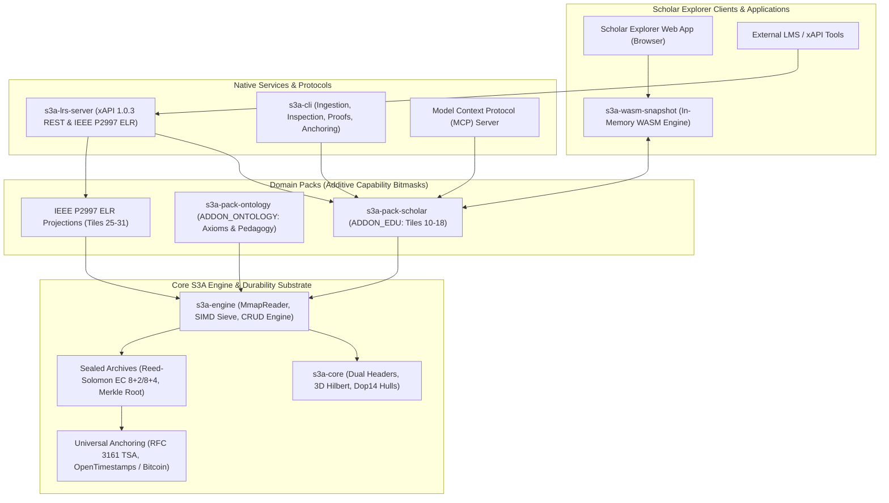

# S3A System Capabilities & Scholar Explorer Architecture Guide

## Executive Summary: Zero External Database Architecture

The **S3A Storage Architecture** (Spatial-Semantic Storage Architecture) is a high-performance, verifiable, and zero-copy binary storage engine designed for high-density multi-modal telemetry, cognitive provenance, and edge-to-cloud data portability.

**S3A is the standalone, primary database engine for Scholar Explorer.** The architecture has **zero external database dependencies**:
* **No DuckDB** (historical DuckDB files `academic.duckdb`, `advisor.duckdb`, and `brain.duckdb` are deprecated legacy formats converted via one-time ingestion into native S3A).
* **No SQLite, PostgreSQL, Kafka, or external document stores**.
* All live querying, xAPI 1.0.3 statement logging, cognitive trace auditing, 3D semantic topic exploration, knowledge graph navigation, and client-side browser evaluation execute natively on S3A binary archives (`*.s3a`) and in-memory WebAssembly views (`s3a-wasm-snapshot`).

---

## 1. System Architecture Overview



---

## 2. Core S3A Storage Engine Capabilities

### 2.1 Physical Storage Model & Dual-Slot Crash Safety
* **128 KB Hyper-Tiles**: Page-aligned allocation blocks designed for modern NVMe drives, OS virtual memory pages, and cloud object stores.
* **4 KB Micro-Tiles**: Scaled down for 4 KB SPI NOR flash erase sectors in embedded, edge, and wearable devices.
* **Dual-Slot Power-Fail Safe Headers (Slot A / Slot B)**:
  - 512-byte page-aligned header block with alternating 64-byte slots (`FILE_HEADER_SLOT_A_OFFSET = 0`, `FILE_HEADER_SLOT_B_OFFSET = 64`).
  - Monotonically increasing sequence counters ensure atomic updates: if a crash or power cut occurs mid-write, the previous valid header slot is automatically selected on recovery.
  - Every header and tile payload carries hardware-accelerated CRC32C checksums.
* **Zero-Copy Memory-Mapped Access (`MmapReader`)**:
  - Eliminates serialization and deserialization overhead.
  - Structs implement `bytemuck::Pod` and `bytemuck::Zeroable`, casting memory buffers directly to native Rust structs in nanoseconds.

### 2.2 3D Spatial-Semantic Indexing & SIMD Query Sieve
* **3D Hilbert Curve Mapping**:
  - Translates continuous 3D semantic topics, coordinates, and embeddings `(x, y, z)` into 1D Hilbert integers.
  - Preserves geometric locality significantly better than Morton (Z-order) curves, ensuring that related academic topics reside within consecutive disk pages.
* **Dop14 Bounding Hulls (Discrete Oriented Polyhedra)**:
  - 14-direction spatial hulls envelope the records of each Hyper-Tile.
  - Query ranges evaluate tile hulls using SIMD matrix comparisons, rejecting irrelevant tiles before disk pages are fetched.
* **SIMD Query Sieve**:
  - Vectorized AVX2 / SSE / NEON filtering evaluates record timestamps, actor IDs, and custom bitmasks at wire speed.
  - Integrated Bloom filters allow instantaneous negative lookups for keywords and claims.

### 2.3 Sealed Archives, Erasure Coding & Self-Repair
* **Immutable Sealed Mode**: Active live databases (`.s3a`) can be compacted and sealed into append-only archival form with a cryptographic Merkle root.
* **Reed-Solomon Erasure Coding**:
  - Generates parity shards ($8+2$ or $8+4$).
  - If bytes, sectors, or whole tiles suffer bit rot or torn writes, the self-repairing reader reconstructs missing data on the fly.
* **Sealed Footer v2**:
  - Carries hardware CRC32C checksums, index hash verification, layout versioning, and end-cap protections preventing truncation attacks.

### 2.4 Universal Trust Anchoring
* **RFC 3161 Time-Stamp Authority (TSA)**: Creates digital notary timestamps proving an archive existed at an exact point in time.
* **OpenTimestamps / Bitcoin Calendar Anchoring**:
  - Derives an archive Merkle root and anchors it into the Bitcoin blockchain via decentralized calendar servers.
  - Provides mathematical, public, and censorship-resistant proof of existence without trusting centralized servers.

### 2.5 Non-Destructive Governance Policy Marks
* Policy governance does not require rewriting or breaking immutable archives.
* Dedicated `MarkRecord` primitives support:
  * `MARK_LEGAL_HOLD`: Freezes records from garbage collection.
  * `MARK_QUARANTINE`: Flags retracted papers or tainted AI outputs; queries hide quarantined records by default unless explicitly requested.
  * `MARK_CONSENT_WITHDRAWN`: Masks participant or researcher identity while keeping cryptographic proof chains intact.
  * `MARK_TOMBSTONE`: Soft-deletes records with full auditability.

---

## 3. How S3A Relates to Scholar Explorer

Scholar Explorer is an AI-assisted scientific discovery and academic research platform. It coordinates human researchers and autonomous AI agents to explore literature, synthesize knowledge graphs, verify empirical claims, and track citations.

### 3.1 Replacement of Legacy DuckDB

| Dimension | Legacy DuckDB Approach | **Native S3A Engine** |
| :--- | :--- | :--- |
| **Database Architecture** | Three separate DuckDB files (`academic`, `advisor`, `brain`) requiring relational SQL queries and complex joins. | **Unified, self-contained S3A binary archives (`.s3a`)**; zero external daemon or process dependencies. |
| **In-Browser Execution** | Heavy DuckDB-WASM binary (~25-40 MB) causing slow cold starts and high browser memory usage. | **`s3a-wasm-snapshot`**: Minimal footprint, instant startup, zero SQL runtime in the browser. |
| **Read Latency** | Deserialization through SQL query execution engines. | **Zero-copy memory mapping (`MmapReader`)**; reads execute in nanoseconds directly against memory-mapped tiles. |
| **Spatial Literature Indexing** | Requires bounding box SQL extensions. | **Native 3D Hilbert Space-Filling Curves & Dop14 Hulls** with SIMD vector rejection. |
| **Tamper Resistance** | Unprotected database files susceptible to silent corruption and undetectable file modifications. | **Dual-slot headers, hardware CRC32C, Reed-Solomon self-repair, and Bitcoin blockchain calendar anchoring**. |
| **LRS / xAPI Support** | Custom relational tables with JSON shredding. | **Native `s3a-lrs-server`** writing directly to append-only binary tiles with zero SQL. |

---

### 3.2 Hyper-Tile Allocation in Scholar Explorer (Tiles 10–18)

All Scholar Pack domain data is mapped into dedicated Hyper-Tiles behind the `ADDON_EDU` (0x0001) capability bitmask:

```
Hyper-Tile 10 ───▶ Human Researcher Decision Ledger (HumanLrsRecord)
Hyper-Tile 11 ───▶ AI Agent Step Trace Log (AiTraceRecord)
Hyper-Tile 12 ───▶ Academic Paper Corpus (AcademicPaperRecord)
Hyper-Tile 13 ───▶ Research Knowledge Graph (ResearchGraphEdgeRecord)
Hyper-Tile 14 ───▶ Active Workspace Context (SrsWorkspaceRecord)
Hyper-Tile 15 ───▶ Authoritative Snapshot Manifest (SrsManifestHeader)
Hyper-Tile 18 ───▶ Task Agent Security Registry (AgentRegistryRecord)
```

#### Tile 10: Human Researcher Decision Ledger (`HumanLrsRecord`)
* Records all human researcher interventions, reviews, approvals, rejections, citations, and ratings.
* Stores actor ID hashes, verb IDs, scaled scores, durations, and spatial coordinates.

#### Tile 11: AI Agent Step Trace Log (`AiTraceRecord`)
* Records step-by-step reasoning sequences performed by autonomous research agents.
* Tracks step kinds (`STEP_REASONING`, `STEP_TOOL_CALL`, `STEP_CLAIM`, `STEP_NOTE`, `STEP_HALLUCINATION`), agent model hashes, confidence scores, and tool bitmasks.

#### Tile 12: Academic Paper Corpus (`AcademicPaperRecord`)
* Stores indexed literature, DOI hashes, publication years, citation counts, and 3D semantic topic coordinates `(topic_x, topic_y, topic_z)` on the Hilbert curve.

#### Tile 13: Research Knowledge Graph (`ResearchGraphEdgeRecord`)
* Captures subject-predicate-object knowledge graphs connecting papers, authors, claims, concepts, and evidence weights.

#### Tile 14: Scholar Research Workspace Context (`SrsWorkspaceRecord`)
* Preserves the active research question, topic centroid coordinates, and collection bitmasks for the ongoing investigation.

#### Tile 15: Authoritative Snapshot Manifest (`SrsManifestHeader`)
* Authoritative manifest holding Project UUID, Snapshot UUID, base generation pointers, layout version (`SCHOLAR_LAYOUT_VERSION_V1 = 1`), and hardware CRC32C checksums.

#### Tile 18: Task Agent Security Registry (`AgentRegistryRecord`)
* Defines and enforces strict operational boundaries for autonomous AI research agents.
* Pre-seeded agent roles:
  * `AGENT_KIND_ORCHESTRATOR`: Coordinates literature search workflows.
  * `AGENT_KIND_VERIFIER`: Verifies claim passage citations and quotes against source texts.
  * `AGENT_KIND_CUSTODIAN`: Handles archival, compression, and snapshot hygiene.
  * `AGENT_KIND_REVIEW_COORDINATOR`: Organizes human peer review feedback.
  * `AGENT_KIND_CITATION_GENERATOR`: Generates bibliographies and companion proofs.
* Hardware-style Tool Permission Bitmasks:
  * `TOOL_READ_FILE`, `TOOL_OPENALEX_QUERY`, `TOOL_CROSSREF_QUERY`, `TOOL_EXTRACT_CLAIMS`, `TOOL_SYNTHESIZE_EVIDENCE`, `TOOL_MUTATE_GRAPH`, `TOOL_EXPORT_SNAPSHOT`, `TOOL_PUBLISH`, `TOOL_CREDENTIAL_EXPORT`.
* Safety Gates:
  * `AGENT_FLAG_REQUIRES_HUMAN_GATE`: Requires a verified human approval record in Tile 10 before actions like graph mutation or publishing are permitted.

---

### 3.3 Bilateral Dual-Actor Provenance

When an AI agent executes tasks and a human researcher reviews the output, S3A ensures non-repudiable auditability through **shared session UUIDs**:
1. When an AI agent performs actions, records are appended to **Tile 11** with a generated 128-bit `session_uuid`.
2. When the human researcher reviews or edits the result, the approval, modification, or rejection record is written to **Tile 10** citing the identical `session_uuid`.
3. Queries can reconstruct the complete cross-trace interaction in a single pass without relational join penalties.

---

### 3.4 Cryptographic Claim Proof Chains & W3C PROV-O JSON-LD

To prevent unverified assertions and hallucinations:
* `ScholarNoteClaimRecord` links an empirical finding directly to:
  * The source paper DOI and content hash (`CitationFingerprintRecord`).
  * Precise passage locators (`passage_page`, `passage_char_offset`, `passage_char_length`).
  * SHA-256 fingerprint of the verbatim quote.
  * Attestation ID and timestamp of the human or agent verifier.
  * Cryptographic Merkle anchor of the snapshot container.
* `s3a-cli scholar proof` exports the chain formatted as **W3C PROV-O JSON-LD**:
  ```json
  {
    "@context": ["https://www.w3.org/ns/prov-o.jsonld", { "s3a": "https://ashecribb.dev/ontologies/scholar/v1#" }],
    "claimId": "s3a:claim_1042",
    "passageLocator": "Page 4, Chars 1200-1450",
    "quoteSha256": "e3b0c44298fc1c149afbf4c8996fb92427ae41e4649b934ca495991b7852b855",
    "sourceDoi": "10.1038/s41586-024-00000-0",
    "snapshotAnchor": "btc:block:860124:tx:0a4f..."
  }
  ```

---

### 3.5 Automated Retraction & Drift Detection (`s3a-cli scholar recheck`)

Scientific literature evolves. The S3A recheck engine audits local paper collections against live upstream academic APIs (Crossref / OpenAlex) and categorizes entries into 4 distinct states:
1. `Unchanged`: Metadata and content fingerprints match upstream.
2. `MetadataShift`: Citation counts or journal volume/issue updated.
3. `VersionDrift`: Preprint superseded or revised by authors.
4. `Retracted`: Paper marked as retracted upstream. Triggers automated `MARK_QUARANTINE` placement in S3A, immediately alerting researchers and filtering the paper from search results.

---

### 3.6 Portable Scholar Research Snapshots (`.snapshot.s3a` / `*.srs.s3a`)

Instead of clumsy SQL dumps:
* **Export**: `s3a-cli snapshot export live.s3a milestone.snapshot.s3a` bundles the workspace, paper corpus, evidence graph, claims, and dual-actor logs into an immutable container with authoritative Tile 15.
* **Inspect**: `s3a-cli snapshot inspect milestone.snapshot.s3a` validates CRC32C checksums, capability bitmasks, and record counts.
* **Intake / Live Mount**: `s3a-cli snapshot intake milestone.snapshot.s3a --into lab_master.s3a` validates and merges records into the target live database with zero data translation.

---

#### 3.6.1 Participant Consent (fail-closed)
* Human (Tile 10) and AI (Tile 11) tracing happens **only** for a consented study participant: the latest Tile-71 `ConsentRecord` must be an active `Research` grant with a non-empty `study_id`.
* Sessions start with no consent. Until granted, `record_human`, `record_ai`, the auto-trace inside `add_claim`, and inbound Tile 10/11 delta entries are silent no-ops (`record_*` return `NOT_RECORDED = u32::MAX`).
* A person's own papers and claims always persist; they are workspace content, not telemetry.
* Every grant, decline, and withdrawal is appended to Tile 71 using s3a-core's hash-chained `ConsentRecord`, so a snapshot carries evidence of the consent decision.
* Withdrawing mid-session stops tracing immediately and appends whole-tile `MARK_CONSENT_WITHDRAWN` marks over Tiles 10 and 11.
* WASM API: `set_consent(granted, purpose, study_id)`, `consent_state()` (`none` / `granted` / `withdrawn`), `recording_active()` (engine truth for the UI indicator).

### 3.7 In-Browser WebAssembly Engine (`s3a-wasm-snapshot`)

The Scholar Explorer web interface runs S3A directly inside researcher browsers using WebAssembly:
* **Browser-Safe Zero-Copy Queries**: The browser reads snapshot byte buffers directly into WebAssembly memory.
* **Pre-flight Agent Validation**: Evaluates agent tool permissions (`can_agent_execute_tool`) client-side before dispatching network requests.
* **Offline Navigation**: Allows searching 3D topic spaces, inspecting citation chains, and browsing knowledge graphs while disconnected from the internet.

---

### 3.8 Standalone xAPI 1.0.3 LRS Server (`s3a-lrs-server`)

For enterprise learning and research compliance:
* Fully compliant with the **ADL xAPI 1.0.3 specification** (1,365/1,365 ADL conformance tests passed green).
* Operates directly on S3A archives with zero external database dependencies.
* Granular authentication credentials with scoped permissions (`read`, `write`, `admin`, `all`).
* Implements the **IEEE P2997 Enterprise Learner Record (ELR)** projection and rules engine across dedicated Hyper-Tiles 25–31 (`Person`, `Organization`, `LearningResource`, `LearningEvent`, `CompetencyAssertion`, `CredentialAssertion`, `Goal`).

---

## 4. CLI Command Reference for Scholar Workflows

### Ingestion & Migration
```bash
# Ingest intermediate NDJSON data into an S3A archive (replaces legacy DuckDB extraction)
s3a-cli scholar ingest scratch/scholar_ingest_v1 scholar.s3a --fresh
```

### Snapshot Management
```bash
# Export a verified snapshot from a live S3A database
s3a-cli snapshot export live.s3a project_milestone.snapshot.s3a

# Inspect snapshot manifest, hardware CRC32, capability mask, and tile counts
s3a-cli snapshot inspect project_milestone.snapshot.s3a

# Zero-copy memory-map intake and verification
s3a-cli snapshot intake project_milestone.snapshot.s3a

# Mount snapshot records into a live database
s3a-cli snapshot intake project_milestone.snapshot.s3a --into live.s3a
```

### Claims, Evidence & Provenance
```bash
# Generate a cryptographic claim proof chain (W3C PROV-O JSON-LD)
s3a-cli scholar proof scholar.s3a --claim 1042 --out claim_1042_proof.json

# Export a bibliography with cryptographic companion verification tokens
s3a-cli scholar export-bib scholar.s3a --format bibtex --out bibliography.bib
```

### Literature Auditing
```bash
# Audit archive literature against upstream APIs for retractions and drift
s3a-cli scholar recheck scholar.s3a --online --out recheck_report.json
```

### Durability & Anchoring
```bash
# Compact and seal an archive with Reed-Solomon erasure coding parity
s3a-cli seal live.s3a sealed.s3a --parity

# Anchor sealed archive to Bitcoin blockchain calendars
s3a-cli anchor sealed.s3a --calendars alice.btc.calendar,bob.btc.calendar

# Verify archive integrity, checksums, and anchor proofs
s3a-cli verify sealed.s3a --anchor
```

### Serving
```bash
# Run the built-in HTTP dashboard and agent console
s3a-cli serve scholar.s3a 8080

# Run the standalone high-throughput xAPI 1.0.3 LRS server
cargo run --bin s3a-lrs-server -- --archive scholar.s3a --port 8081
```
