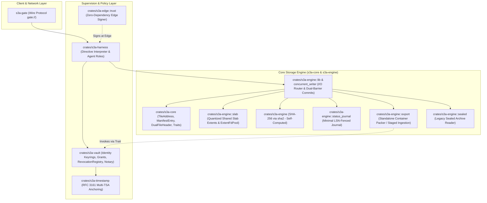

# S3A Mobile Tile Model: Database Storage Engine & Modular Architecture

*   **Author:** Ashley
*   **Status:** Draft
*   **Date:** 2026-10-31

--------------------------------------------------------------------------------

## Overview

The S3A Mobile Tile Model establishes a database storage architecture where the fundamental unit of storage is a portable, self-authenticating record called a Capsule Tile. Rather than locking records into node-specific page layouts and central schema catalogs, Capsule Tiles retain their cryptographic provenance, headers, and boundaries across transport and cold storage.

Composite containers, termed Compound Tiles, aggregate member tiles with physical slab alignment and copy-on-write atomic manifests. S3A Core (`s3a-core` / `s3a-engine`) acts strictly as a transactional storage engine, handling physical I/O, quantized allocation, and hash verification (`sha2` / SHA-256), while delegating identity, access control, and directive interpretation to modular domain packs.

Because existing S3A Core deployments historically included archive signing and sealing routines, adopting this model involves a planned migration: existing signature and public key validation logic is extracted from Core and transitioned into `s3a-vault` (leveraging `crates/s3a-edge::trust` for lightweight edge signing), leaving Core purely responsible for low-level byte and hash operations.

## The Problem

Traditional database engines tightly couple records to internal page layouts, system tables, and central transaction coordinators. This design creates several operational barriers:

1.  **Immobility and Detached Provenance:** Transferring records to edge nodes, air-gapped systems, or cold archives requires exporting and transforming data into secondary formats. During this transfer, original cryptographic proof of authorship is typically lost or detached from the physical data.
2.  **Centralized Verification Bottlenecks:** Validating record integrity currently often requires access to the originating database catalog. Independent third parties cannot verify extracted records in isolation.
3.  **Cascading Write Penalties in Deep Hierarchies:** Storing hierarchical telemetry (such as high-frequency sensor readings rolled up into hourly, daily, and annual batches) with recursive container-in-container packaging forces complete re-compression and re-writing of massive archive files whenever a single data point is appended or revised.
4.  **Architectural Bloat in the Storage Core:** Database engines frequently accumulate extraneous responsibilities—such as identity mapping, role evaluation, and script execution—which expands the attack surface, complicates crash safety, and creates tight coupling across unrelated subsystems.

## Goals

*   **Self-Contained Provenance:** Enable standalone verification of individual Capsule Tiles using canonical raw payload hashes (SHA-256 via `sha2`) and author signatures (signatures checked by `s3a-vault`), allowing verification independent of a master database catalog.
*   **Controlled Write Pathway:** Ensure all mutations reach Core through a single authenticated caller—the local runtime harness (`s3a-harness`)—only after author signatures and capability grants have been validated by `s3a-vault`.
*   **Continuous Node-Wide Storage Auditing:** Enable audit agents (Sentinels) to periodically re-evaluate cryptographic signatures on stored tiles against current `s3a-vault` revocation records (using `crates/s3a-vault/src/rotation.rs`) and trusted commit/ingress timestamps, applying a synchronous, node-wide quarantine status across all container references via an atomic LSN-fenced log-backed status table in Core.
*   **Human-Supervised Reversible Quarantine:** Ensure Sentinel quarantining is strictly a non-destructive, reversible hold (`STATUS_QUARANTINED = 0x1`). Sentinels cannot delete data; only an authorized human administrator may clear a quarantine hold or confirm permanent invalidation. Local transitions follow causal LSN order.
*   **Direct Pass-Through Relaying:** Allow relay nodes (Couriers) to transport and cache sealed tiles over network connections without inspecting, decoding, or re-encoding tile contents.
*   **Predictable Memory and Bounded Fragmentation:** Constrain worst-case internal storage fragmentation to 33.3% above 8 KB using 10 quantized slab size classes (4 KB to 128 KB, with 1.5x intermediate stepping), preventing arbitrary memory allocation during reads and writes.
*   **Crash-Safe Atomic Updates:** Guarantee write consistency and crash recovery for Compound Tile containers using the canonical 512-byte `DualFileHeader` (64-byte Slot A / Slot B), descriptor-level write mutex / file locking (`fs2::FileExt::lock_exclusive`), multi-file write barriers (`fsync` to both slab extent and descriptor files prior to header write), copy-on-write manifest appends without full-table locks, and free-slot bitmap rebuild during crash recovery.
*   **Strict Component Separation and Code Migration:** Migrate archive signing and cryptographic key logic out of Core into `s3a-vault` and `s3a-edge`, leaving Core exclusively responsible for physical tile I/O, slab allocation, and SHA-256 hash validation.

## Non-Goals

*   **In-Tile Dynamic Compute in Core:** S3A Core will not execute bytecode, scripts, or active logic embedded within tiles. Directive execution is strictly declarative and isolated to runtime harnesses.
*   **Identity Resolution or Signature Verification in Core:** `s3a-core` / `s3a-engine` will not store public keys, resolve user profiles, or verify cryptographic signatures. Core exclusively validates SHA-256 content and stored-blob hashes.
*   **Multi-Level Physical Byte Nesting:** Compound Tiles will never physically embed other Compound Tiles within raw byte streams. Hierarchical collections must use logical manifest references (Merkle DAGs).
*   **Autonomous Agent Record Deletion:** Automated agents (Sentinels) are strictly barred from deleting or overwriting records. Agents may only audit integrity and set quarantine flags in Core's status log, reserving destructive modifications for authorized human administrators.

--------------------------------------------------------------------------------

## Critical User Journeys (CUJs)

### CUJ 1: Ingesting High-Frequency Stream Telemetry
*   **Given:** An edge sensor emitting rapid micro-tile readings.
*   **When:** The configured time or byte window closes, triggering batch packaging.
*   **Then:** Windowed records pass to `s3a-harness`; edge signing primitives (`crates/s3a-edge::trust` / `s3a-vault-signer`) attach author credentials trailing the raw payload; `s3a-engine` independently computes SHA-256 hashes, records a trusted UTC wall-clock `FirstCommittedAt` timestamp, appends the tiles into the node's shared size-class slab extents, and commits a Compound Tile with an A/B header update.

### CUJ 2: Courier Relay Over Network Boundaries
*   **Given:** A sealed Compound Tile stored on a local node that needs replication to a remote cluster.
*   **When:** A Courier agent receives an export directive.
*   **Then:** `s3a-engine` creates a standalone `.s3a` file: it reads each referenced member's current status and `FirstCommittedAt` timestamp from the node status table, requests an export notary signature via the `ExportNotary` trait (implemented by `s3a-vault`), embeds these records into the exported manifest, and packs the container headers and verbatim compressed member bytes. The Courier streams this standalone file over `gate://`.

### CUJ 3: Continuous Integrity Audit and Reversible Administrative Quarantine
*   **Given:** Stored tiles on disk and a key revocation registered in `s3a-vault` with `revocation_effective_timestamp = T_revoked`.
*   **When:** A Sentinel agent performs a background audit cycle.
*   **Then:** The Sentinel reads stored tiles from `s3a-engine` and submits their signatures and trusted arrival/commit timestamps (`FirstCommittedAt` or authenticated `SourceNotarizedAt`) to `s3a-vault` (`RevocationRegistry::check_key_valid()`). The author's unverified `signed_at` is untrusted on its own. If the trusted timestamp is at or after `T_revoked` (or missing), the Sentinel issues an atomic status update: `s3a-engine` appends a quarantine entry with incremented LSN to its append-only `status.log` and updates its in-memory status index. Any subsequent read of that `TileID` across **any** container on the node is immediately rejected with `TileQuarantinedError`. This quarantine is a non-destructive administrative hold; local transitions operate in causal LSN order, allowing an authorized administrator to lift the hold (`STATUS_ACTIVE = 0x0`) with a higher LSN without getting blocked by "strictest-wins".

### CUJ 4: Atomic Member Update in a Compound Tile
*   **Given:** An existing Compound Tile with active metadata in Header Slot A of its canonical 512-byte `DualFileHeader`.
*   **When:** A member tile is updated with modified contents.
*   **Then:** The writer acquires the descriptor-level exclusive write lock via `fs2::FileExt::lock_exclusive`. The new member is written to the next free slot in the corresponding shared slab extent file (`.slab`); a new manifest is appended to the descriptor file; separate `fsync` barriers are issued to **both** the `.slab` extent file and the descriptor file ensuring member bytes and manifest are durable on disk; Header Slot B (offset 64) is updated with incremented generation number and the new manifest pointer; a final `fsync` barrier is issued on the descriptor file ensuring the 512-byte header block is durable; the write lock is released. If power fails at any point prior to the header `fsync`, Header Slot A remains active and consistent, and free-space allocators rebuild allocation bitmaps from live manifests during recovery.

--------------------------------------------------------------------------------

## Technical Plan (Architecture)

### Architectural Component Decomposition

The system is decomposed into distinct workspace crates with strict boundaries, using dependency inversion to avoid cyclic dependencies:



### 1. Two-Stage Physical Layout Architecture

The storage layout operates across two distinct operational stages:

```
[ Active Node Storage (Shared Volume Extents) ]
+------------------------------------------+      Points to shared pool
| Compound Tile Descriptor                 |------------------------------------+
| - Canonical DualFileHeader (512B)        |                                    |
|   * Slot A (64B at offset 0)             |                                    |
|   * Slot B (64B at offset 64)            |                                    |
|   * Padding (384B)                       |                                    |
| - Manifest (Append-Only COW)             |                                    |
+------------------------------------------+                                    |
                                                                                v
+--------------------------------------------------------------------------------------------+
| Shared Volume Slab Extents (.slab) - slabs/class_{id}/extent_{id:07x}.slab                 |
| [Ext 1: 4KB Slots]   | SlotExtentHeader (4KB) | Slot 0 (Tile 101) | Slot 1 (Tile 108) | ...  |
| [Ext 2: 16KB Slots]  | SlotExtentHeader (4KB) | Slot 0 (Tile 102) | Slot 1 (Tile 115) | ...  |
+--------------------------------------------------------------------------------------------+
                                      |
                 Export / Seal for Transport (Direct Pass-Through Relaying)
                                      v
[ Exported Wire / Cold Archive File (Standalone .s3a File) ]
+--------------------------------------------------------------------------------------------+
| Standalone Container (.s3a)                                                                |
| - Canonical DualFileHeader (512B)                                                          |
| - Manifest (Populated with Node Tile Statuses & Notarized Timestamps)                      |
| - Contiguous Packed Member Bytes (Raw compressed bytes copied verbatim)                    |
+--------------------------------------------------------------------------------------------+
```

1.  **On-Node Active Working Storage (Shared Slab Extents):**
    *   The volume maintains shared slab extent files (`.slab`) segregated by size class (`[4, 8, 12, 16, 24, 32, 48, 64, 96, 128 KB]`).
    *   Compound Tiles are stored as lightweight descriptor files containing the canonical 512-byte `DualFileHeader` (Slot A and Slot B) and an append-only manifest area.
    *   Manifest entries index members using global 64-bit coordinates: `(size_class_id, slab_extent_id, slot_index)`.
    *   This pools capacity across all containers on a node, reduces disk fragmentation, and amortizes allocation.
2.  **Transport & Cold Archive Storage (Standalone Exported `.s3a` Files):**
    *   When a Compound Tile is sealed for export, network transmission over `gate://`, or long-term cold archiving, Core executes a zero-recompression, zero-resigning packing routine.
    *   Core reads the current status for each member from its node status table, includes the source node's `FirstCommittedAt` timestamp authenticated by an `ExportNotary` trait implementation from `s3a-vault`, and packs the container headers, manifest, and verbatim compressed member bytes into a single `.s3a` file.
    *   **Trust-Gated Ingestion & Staging Policy:**
        *   **Staging Isolation:** Imported archives are initially held in a filesystem staging directory (`staging/unverified_import.s3a`). They are **never** directly ingested into active engine slab arenas until provenance and signatures are verified.
        *   **Trusted Source:** If the receiving node's `s3a-vault` trusts the source node's export notary key (verified via `PeerKeyVerifier` trait), the source node's `FirstCommittedAt` timestamp is accepted as authentic, and imported `QUARANTINED` statuses are merged into the local status table under a **strictest-wins** rule (`QUARANTINED` > `SUPERSEDED` > `ACTIVE`). Once verified, members are migrated into active shared slabs.
        *   **Untrusted Source:** If the source node is untrusted, imported quarantine statuses are not merged directly; instead, they are recorded as advisory hints for a local Sentinel agent to audit independently. The tile remains in staging until a Sentinel verification pass confirms validity.

### 2. Node-Wide Tile Status Journal & Checkpointing (Minimal LSN-Fenced)

To ensure synchronous and uniform quarantine across all containers referencing a tile without mutating member bytes, while avoiding relational database engine bloat (Alternative 5):

1.  **Append-Only Status Journal (`status.log`):**
    All status changes are committed to an append-only transaction log in Core with monotonic Log Sequence Numbers (LSN):

| Field | Type | Offset | Description |
| :--- | :--- | :--- | :--- |
| `lsn` | `u64` | 0 | Monotonically increasing Log Sequence Number |
| `tile_id` | `[u8; 16]` | 8 | 128-bit Tile UUID |
| `status_byte` | `u8` | 24 | `0x0 (ACTIVE)`, `0x1 (QUARANTINED)`, `0x2 (SUPERSEDED)` |
| `timestamp` | `u64` | 25 | UTC wall-clock epoch timestamp |
| `actor_id` | `[u8; 16]` | 33 | Agent / Admin identity identifier |
| `crc32c` | `u32` | 49 | Castagnoli CRC32C checksum over prior fields |

2.  **Causal Local Transitions vs Strictest-Wins Import:**
    *   **Local Mutations:** Within the local node, status transitions evaluate in causal log order (higher LSN wins). A human administrator issuing an un-quarantine directive appends an entry with `status_byte = 0x0 (ACTIVE)` and a new LSN, which cleanly supersedes the prior `0x1 (QUARANTINED)` hold.
    *   **External Merge:** "Strictest-wins" (`QUARANTINED` > `SUPERSEDED` > `ACTIVE`) applies strictly when merging metadata during trusted foreign container ingestion, preventing external sources from overriding local or remote security holds.

3.  **Crash-Safe Checkpointing with LSN Fencing:**
    To prevent unbounded growth of `status.log`, Core executes a periodic status checkpoint when the log reaches a size threshold (e.g., 64 MB) or during clean shutdown:
    *   Core identifies the current high-water mark: $LSN_{\text{checkpoint}}$.
    *   Core writes out a compact binary snapshot of all effective statuses up to $LSN_{\text{checkpoint}}$ to `status.snapshot.tmp`.
    *   Core flushes `status.snapshot.tmp` via `fsync`.
    *   Core atomically renames `status.snapshot.tmp` over the active `status.snapshot`.
    *   Core issues a directory sync barrier ensuring the rename metadata is durable.
    *   **LSN-Fenced Pruning:** Core rotates or truncates only log entries with $LSN \le LSN_{\text{checkpoint}}$. Any mutations appended concurrently during snapshot creation (with $LSN > LSN_{\text{checkpoint}}$) are preserved and never clobbered.
    *   If a crash occurs before the rename, recovery replays the existing snapshot and full log.

4.  **Rebuildable Index:**
    `s3a-engine` serves reads using an in-memory index mapping `TileID -> StatusByte`. If the index is missing or corrupted on startup, Core replays the snapshot and log in sequence.

5.  **Read Enforcement & Administrative Remediation:**
    When any caller attempts to read a `TileID` through any Compound Tile, Core consults the status index. If marked `0x1` (`QUARANTINED`), Core rejects the call with `TileQuarantinedError` unless an administrative flag (`allow_quarantined: true`) is explicitly passed.

### 3. Two-Layer Integrity Model & Core Hash Enforcement

Integrity verification is separated into distinct cryptographic domains:

1.  **Inner Layer (Provenance & Identity):**
    *   Member tiles carry an author signature over the canonical header and raw, uncompressed payload:
        $$\text{Signature} = \text{Sign}_{\text{AuthorKey}}(\text{CanonicalHeader} \parallel \text{RawPayload})$$
    *   **Physical Binary Framing:** Capsule Tiles adopt trailing signature wire framing:
        ```
        +-----------------------+-------------------------+----------------------+
        | CanonicalHeader (var) | RawPayload (var bytes)  | Ed25519 Sig (64B)    |
        +-----------------------+-------------------------+----------------------+
        ```
    *   Signature validation, key lifecycle, and revocation tracking are exclusively handled by `s3a-vault`.
    *   Because the author signature covers the canonical tile header, **the bytes of a sealed Capsule Tile on disk are strictly immutable**.

2.  **Outer Layer (Physical Storage & I/O Integrity):**
    *   Compound Tile manifests record:
        $$\text{ManifestEntry} = \{\text{TileID}, \text{TileAddress}, \text{Length}, \text{Codec}, \text{HashAlgo}, \text{RawHash}, \text{StoredBlobHash}, \text{FirstCommittedAt}\}$$
    *   `s3a-engine` **never** accepts caller-supplied hashes. Core independently computes both SHA-256 hashes directly from memory buffers using `sha2`:
        *   $\text{RawHash} = \text{SHA-256}(\text{CanonicalHeader} \parallel \text{RawPayload})$
        *   $\text{StoredBlobHash} = \text{SHA-256}(\text{CompressedBytesOnDisk})$
    *   **Forward Agility:** `ManifestEntry` includes a 1-byte `hash_algo` identifier (`0x01 = SHA-256`), allowing edge micro-tiles to introduce Blake3 (`0x02`) in future revisions without breaking binary format layout.
    *   Any hash supplied by an external caller is completely ignored, preventing forged or buggy caller metadata from polluting storage records.

3.  **Anti-Backdating Trusted Timestamp Verification:**
    Because an author can fabricate the self-asserted `SignedAt` timestamp inside a canonical header, `s3a-vault` evaluates revocation boundaries using only trusted external wall-clock timestamps:
    *   **Local Writes:** The UTC wall-clock `FirstCommittedAt` timestamp recorded by `s3a-engine` in the manifest entry during initial commit.
    *   **Trusted Import:** An authenticated `SourceNotarizedAt` timestamp countersigned by a trusted source node's vault in an exported `.s3a` manifest.
    *   **Untrusted Import:** Staged until audited; arrival time bound to receiving node's local `IngressNotarizedAt`.
    *   **Verification Rule:** Handled via `crates/s3a-vault/src/rotation.rs` (`RevocationRegistry::check_key_valid()`). If a key is revoked at $T_{\text{revoked}}$, tiles with a trusted timestamp prior to $T_{\text{revoked}}$ remain valid. Any tile whose trusted timestamp is at or after $T_{\text{revoked}}$, or any tile presenting only an unnotarized author timestamp, is treated as untrusted and flagged for quarantine.

### 4. Quantized Slab Allocation, Extent Header & 64-Bit Addressing

*   **Size Classes (1.5x Stepping):** 10 quantized classes: `[4, 8, 12, 16, 24, 32, 48, 64, 96, 128 KB]`. Bounded worst-case internal fragmentation is 33.3% above 8 KB.
*   **Decompression Ceiling Check:** Core enforces a strict ceiling check before decompression: any tile whose manifest declares `uncompressed_len > 131,072` bytes (128 KB) is rejected immediately with `PayloadExceedsClassLimit`, preventing decompression memory amplification attacks.
*   **64-Bit Physical Tile Addressing (`TileAddress`):**

| Bits | Field | Width | Description |
| :--- | :--- | :--- | :--- |
| `[63..60]` | `size_class_id` | 4 bits | Index into the 10 quantized size classes (0..9) |
| `[59..32]` | `slab_extent_id` | 28 bits | Extent file identifier (up to $2.68 \times 10^8$ extents) |
| `[31..8]` | `slot_index` | 24 bits | Slot index within extent (up to $16,777,216$ slots) |
| `[7..0]` | `_reserved` | 8 bits | Reserved for future alignment / flag extensions |

*   **Deterministic Offset:** $\text{PhysicalOffset} = 4096 + (\text{slot_index} \times \text{ClassSizeBytes})$.
*   **Extent File Naming and Header:**
    *   Directory structure: `slabs/class_{size_class_id}/extent_{slab_extent_id:07x}.slab`.
    *   Header (`SlabExtentHeader`, 4096 bytes, 8-byte aligned):
        ```rust
        #[repr(C, align(8))]
        pub struct SlabExtentHeader {
            pub magic: [u8; 8],          // b"S3ASLAB1"
            pub extent_id: u32,
            pub size_class_id: u8,
            pub _reserved: [u8; 3],
            pub slot_count: u32,
            pub slot_size_bytes: u32,
            pub allocation_bitmap: [u8; 4072], // Tracks slot occupancy
        }
        ```
*   **Extent File Descriptor Pool (`ExtentFdPool`):**
    To prevent hitting OS open-file limits when thousands of `.slab` files exist, `s3a-engine::slab` manages an LRU pool of open file descriptors (`ExtentFdPool`), transparently opening and closing OS handles as accesses occur across size classes.

### 5. Crash-Safe Canonical 512-Byte DualFileHeader Commit Sequence

Compound Tile descriptors strictly adhere to the canonical 512-byte `DualFileHeader` standard (`crates/s3a-core/src/lib.rs`), consisting of two 64-byte metadata slots: `Slot A` (offset 0) and `Slot B` (offset 64), followed by 384 bytes of padding.

Because member tile payloads reside in a shared `.slab` extent file while the manifest and headers reside in the container descriptor file, two separate file handles are mutated. To guarantee durability and prevent torn pointer references, the writer must issue separate `fsync` barriers to **both** files before the inactive header slot is committed:

```
Mutation Commit Sequence (Multi-File Dual-Barrier Ordering with Concurrency Lock):
1. Acquire Lock: Writer acquires exclusive descriptor write lock via fs2::FileExt::lock_exclusive.
2. Write Member Bytes: Core writes compressed tile payload into the next free slab slot in the .slab extent file.
3. Append Manifest: Core appends updated manifest entry mapping member TileIDs to slab addresses into the descriptor file,
   recording hash_algo (SHA-256), RawHash, StoredBlobHash, and FirstCommittedAt (UTC wall-clock).
4. Pre-Header Write Barriers (Both Files):
   a. Slab Extent Barrier: Core issues fsync (file.sync_data()) on the .slab extent file, ensuring member bytes are durable.
   b. Descriptor Barrier: Core issues fsync (file.sync_data()) on the descriptor file, ensuring the appended manifest is durable.
   (Both fsync operations must succeed before advancing to Step 5).
5. Update Header Slot: Core writes the inactive 64-byte header slot (Slot B if Slot A is current) with
   generation = active_slot.generation + 1, updated manifest offset/length, and header_crc32.
6. Header Write Barrier: Core issues fsync (file.sync_all()) on the descriptor file, ensuring the 512-byte header block is durable on disk.
7. Release Lock: Writer releases descriptor write lock.
8. Acknowledge: Core returns write success to s3a-harness.
```

*   **Crash Recovery & Free-Slot Bitmap Rebuild:** If power fails prior to step 6, the system boots into the last durable header slot. During crash recovery, the slab extent manager scans all live container manifests to rebuild free-slot bitmaps, reclaiming any unreferenced slab slots allocated during interrupted writes without requiring complex transaction logs.

--------------------------------------------------------------------------------

## Alternatives Considered

### Alternative 1: Pure Power-of-Two Slab Allocation (4, 8, 16, 32, 64, 128 KB)

*   **Description:** Use strictly power-of-two size classes for slab extents.
*   **Pros:** Requires only 6 active slab arenas; bitmask math for slot calculation is trivial.
*   **Cons:** Worst-case internal fragmentation reaches 49.9% (for instance, a 32.01 KB compressed tile occupies a 64 KB slot, wasting 31.99 KB).
*   **Reason for Rejection:** High storage waste on memory-constrained devices. Adopting 1.5x intermediate stepping (`[4, 8, 12, 16, 24, 32, 48, 64, 96, 128 KB]`) caps worst-case waste at 33.3% above 8 KB while requiring only 4 additional extent files.

### Alternative 2: Signing Compressed On-Disk Bytes Directly

*   **Description:** Have the author's cryptographic signature commit directly to the compressed on-disk payload rather than canonical raw bytes.
*   **Pros:** A single signature check verifies both author authenticity and physical on-disk storage layout.
*   **Cons:** Cryptographic provenance becomes permanently coupled to the initial compression codec and level. Recompressing data from edge devices (LZ4) to cold archives (Zstandard) or adjusting compression ratios invalidates the original author's signature, requiring re-signing by authors who may no longer exist.
*   **Reason for Rejection:** Breaks archive migration and long-term storage lifecycle flexibility. Decoupling the inner signature (canonical raw payload) from the outer manifest hash (physical compressed bytes) allows safe re-compression across storage tiers.

### Alternative 3: Recursive Physical Container Nesting (Compound Tiles Inside Compound Tiles)

*   **Description:** Physically embed hourly Compound Tile bytes directly inside daily Compound Tile files, and daily files inside annual archive files.
*   **Pros:** Every stage of the hierarchy exists as a single standalone file on disk.
*   **Cons:** Updating or replacing a single 4 KB micro-tile requires decompressing, re-compressing, and rewriting the entire multi-gigabyte parent archive file. Decompressing deeply nested containers also causes severe memory amplification on edge nodes.
*   **Reason for Rejection:** Creates catastrophic write amplification in time-series telemetry. Capping physical byte-in-byte encapsulation at 1 level and modeling higher-level hierarchies via logical manifest DAG references eliminates cascade rewrites.

### Alternative 4: Retaining Signature and Key Verification Inside Core Engine

*   **Description:** Keep public key verification, identity keyrings, and Ed25519 routines embedded within `s3a-core` / `s3a-engine`.
*   **Pros:** Core independently validates author signatures before writing bytes to disk.
*   **Cons:** Expands the database engine binary with identity parsing, certificate handling, and network directory dependencies. Creates tight coupling between low-level block I/O and identity policy.
*   **Reason for Rejection:** Violates database single-responsibility principles. Delegating public keys and signatures to `s3a-vault` while keeping Core strictly responsible for physical I/O and SHA-256 hashes produces a smaller, more auditable, and more resilient storage kernel.

### Alternative 5: Minimal LSN-Fenced Status Journal vs Full RDBMS/WAL Transaction Engine

*   **Description:** Build a general-purpose write-ahead logging (WAL) transaction engine with multi-table ACID transactions, MVCC, and rollbacks inside `s3a-engine`, OR conversely eliminate the journal entirely and store quarantine flags only inside individual manifests.
*   **Pros:** Full WAL supports arbitrary relational mutations; manifest-only avoids a node-wide journal file.
*   **Cons:** Full WAL introduces massive complexity, disk write overhead, and micro-RDBMS creep into what should be a fast block/tile engine. Conversely, manifest-only quarantine cannot achieve atomic node-wide quarantine across multiple containers referencing the same tile without multi-file cascading writes that fail crash atomicity.
*   **Reason for Rejection:** The system retains the status journal, but keeps it strictly minimal: an append-only LSN-fenced log with periodic snapshot compaction. No general transaction engine, table locks, or multi-statement transactions are introduced into Core, satisfying node-wide quarantine safety with minimal code surface.

--------------------------------------------------------------------------------

## Open Questions

*   **Question 1: Slab Compaction Thresholds:** What specific ratio of superseded-to-live slots within a shared slab extent should trigger background vacuuming, and how should concurrent readers be coordinated during extent compaction?
*   **Question 2: Ingestion Strategy for Standalone Archives:** When an exported `.s3a` file arrives at a new node and passes verification, should the default behavior mount the file directly in place as a read-only extent, or unpack its members into the node's local shared slab extents?

--------------------------------------------------------------------------------

## Non-Functional Requirements

### Security & Integrity
*   **Tamper Evidence:** Any modification to compressed data on disk is detected via SHA-256 `StoredBlobHash` before decompression. Any alteration to uncompressed data or headers invalidates the SHA-256 `RawHash` and author cryptographic signature.
*   **Cryptographic Agility:** `ManifestEntry` records a 1-byte hash algorithm ID (`0x01` for SHA-256), allowing seamless future extension to Blake3 or post-quantum digests without breaking storage binary framing. Canonical raw headers include signature algorithm identifiers for Ed25519 migration.
*   **Least Privilege:** Couriers and network relays require zero access to decryption keys, author public keyrings, or unsealed payloads to forward tiles over `gate://`.

### Performance & Latency
*   **Direct Physical Slab Addressing:** Computing physical file offsets requires only bit-shifting the 64-bit `TileAddress` plus a single lookup to resolve the active extent file descriptor from `ExtentFdPool`, eliminating multi-hop index traversals.
*   **Bounded Decompression Memory:** Maximum uncompressed buffer allocation is strictly capped at 128 KB per read via pre-decompression ceiling verification (`PayloadExceedsClassLimit`).
*   **Status Check Latency Target:** Target sub-millisecond status resolution via the in-memory/mmap status index on hot read paths.

### Reliability & Crash Recovery
*   **Atomic Sector Writes:** Dual 64-byte header slots within the canonical 512-byte `DualFileHeader` guarantee that metadata commits are atomic at the physical sector level. Power loss during writes falls back to the previous sequence number without corrupted manifests.
*   **Multi-File Pre-Header Fsync Barriers:** Member bytes written to `.slab` extent files and manifest entries written to descriptor files are both flushed via individual `fsync` barriers prior to committing the header slot, eliminating torn pointer hazards across disparate physical files.
*   **Durable Checkpoint Ordering:** Checkpoint compaction writes to a temporary file, fsyncs, renames atomically, syncs the parent directory, and only then prunes status journal records $\le LSN_{\text{checkpoint}}$, eliminating window-of-vulnerability data loss.
*   **Free-Slot Rebuild on Recovery:** Interrupted writes that allocate slab slots without committing a header slot are automatically reclaimed during restart by scanning live manifests.

--------------------------------------------------------------------------------

## Detailed Implementation Plan

### Target Files to Create/Modify

#### 1. `crates/s3a-core/src/schema.rs` & `crates/s3a-core/src/lib.rs` (Modify)
*   **Type / Scope:** Core Data Layout & Binary Definitions
*   **Proposed Changes:**
    *   Define explicit POD structs (`#[repr(C, align(8))]` with `bytemuck` traits `Pod`, `Zeroable`):
        *   `TileAddress`: `size_class_id` (4b), `slab_extent_id` (28b), `slot_index` (24b), `_reserved` (8b). Total 64 bits.
        *   `ManifestEntry`: `tile_id: [u8; 16]`, `address: TileAddress`, `length: u32`, `codec: u8`, `hash_algo: u8` (`0x01` = SHA-256), `raw_hash: [u8; 32]`, `stored_blob_hash: [u8; 32]`, `first_committed_at: u64`. (Eliminates redundant `SizeClass`).
        *   `StatusLogEntry`: `lsn: u64`, `tile_id: [u8; 16]`, `status_byte: u8`, `timestamp: u64`, `actor_id: [u8; 16]`, `crc32c: u32`.
    *   Declare constants for the 10 quantized slab size classes: `[4, 8, 12, 16, 24, 32, 48, 64, 96, 128 KB]`.
    *   Define status code constants: `STATUS_ACTIVE = 0x0`, `STATUS_QUARANTINED = 0x1`, `STATUS_SUPERSEDED = 0x2`.
    *   Define traits to break circular dependency with `s3a-vault`:
        ```rust
        pub trait ExportNotary: Send + Sync {
            fn notarize_export(&self, manifest_bytes: &[u8], timestamp: u64) -> Result<Vec<u8>, s3a_core::Error>;
        }
        pub trait PeerKeyVerifier: Send + Sync {
            fn verify_peer_export(&self, peer_id: &[u8; 16], manifest_bytes: &[u8], sig: &[u8]) -> Result<bool, s3a_core::Error>;
        }
        ```
    *   Retain canonical 512-byte `DualFileHeader` (`slot_a: FileHeader`, `slot_b: FileHeader`, `_padding: [[u64; 16]; 3]`).

#### 2. `crates/s3a-engine/src/slab.rs` (Create)
*   **Type / Scope:** Physical Storage Allocator & File Descriptor Pool
*   **Proposed Changes:**
    *   Implement `QuantizedSlabManager` to manage size-segregated `.slab` extent files on disk.
    *   Implement `SlabExtentHeader` (4096-byte aligned header with magic `b"S3ASLAB1"`, `extent_id: u32`, `size_class_id: u8`, `slot_count: u32`, allocation bitmap).
    *   Implement `ExtentFdPool`: an LRU cache of open OS file descriptors to prevent exhaustion across large extent counts.
    *   Implement deterministic $O(1)$ offset calculation: $\text{PhysicalOffset} = 4096 + (\text{slot_index} \times \text{ClassSizeBytes})$.
    *   Implement allocation, free-slot bitmap tracking, and recovery-time bitmap rebuild from live manifests.

#### 3. `crates/s3a-engine/src/status_journal.rs` (Create)
*   **Type / Scope:** Minimal LSN-Fenced Status Ledger & Crash Recovery
*   **Proposed Changes:**
    *   Implement append-only `status.log` write path with monotonic LSN, UTC wall-clock timestamps, and Castagnoli CRC32C.
    *   Implement in-memory status index mapping `TileID` to effective status byte. Local updates evaluate in causal LSN order (latest LSN wins, allowing admin un-quarantine).
    *   Implement crash-safe checkpointing: write deduplicated snapshot up to $LSN_{\text{checkpoint}}$ to `status.snapshot.tmp`, `fsync`, atomically rename to `status.snapshot`, sync parent directory, and prune log records $\le LSN_{\text{checkpoint}}$ without clobbering concurrent entries.
    *   Implement startup recovery: load snapshot and replay trailing log delta.

#### 4. `crates/s3a-engine/src/export.rs` (Create)
*   **Type / Scope:** Standalone Container Packing & Staged Ingestion
*   **Proposed Changes:**
    *   Implement `export_container()`: reads referenced member bytes verbatim from shared slabs, fetches current statuses from `status_journal`, embeds `FirstCommittedAt`, invokes `&dyn ExportNotary` to countersign, and writes a contiguous standalone `.s3a` file.
    *   Implement `import_container()`: isolates imported archives in `staging/unverified_import.s3a`. Verifies peer notary signatures using `&dyn PeerKeyVerifier`. For trusted sources, merges statuses under strictest-wins and migrates data into active slabs; for untrusted sources, emits advisory hints for Sentinel audit.

#### 5. `crates/s3a-engine/src/lib.rs` & `crates/s3a-engine/src/concurrent_writer.rs` (Modify)
*   **Type / Scope:** Engine Module Root, Commit & Read Path
*   **Proposed Changes:**
    *   Reassign active container A/B commit sequence from `sealed.rs` to `lib.rs` / `concurrent_writer.rs`:
        *   Acquire descriptor-level exclusive write lock via `fs2::FileExt::lock_exclusive`. (Note on dependency: `fs2 = "0.4"` is already directly declared in `crates/s3a-engine/Cargo.toml:37` and used in `crates/s3a-engine/src/lib.rs`; promote `fs2 = "0.4"` to `[workspace.dependencies]` in root `Cargo.toml` for workspace standardization).
        *   Write member slab bytes to the `.slab` extent file.
        *   Append manifest entry to descriptor file with SHA-256 hashes and `hash_algo: u8 = 1`.
        *   **Multi-File Pre-Header Fsync Barriers:** Issue `file.sync_data()` on the `.slab` extent file AND `file.sync_data()` on the descriptor file, ensuring both separate files are durable before touching the header.
        *   Update inactive 64-byte header slot in canonical 512-byte `DualFileHeader`.
        *   Issue final `file.sync_all()` on the descriptor file header block.
        *   Release descriptor write lock.
    *   Enforce hard ceiling check before decompression (`uncompressed_len <= 131,072`).
    *   Consult `status_journal` on `read_tile()`, returning `TileQuarantinedError` if status is `0x1` unless `allow_quarantined: true` is passed.

#### 6. `crates/s3a-engine/src/sealed.rs` (Modify)
*   **Type / Scope:** Legacy Format & Cold Archive Parsing
*   **Proposed Changes:**
    *   Retain exclusively for legacy container format parsing and cold archive endcap generation, decoupled from the active concurrent writer.

#### 7. `crates/s3a-edge/src/trust.rs` & `crates/s3a-vault-signer` (Modify/Create)
*   **Type / Scope:** Lightweight Edge Signer Primitives
*   **Proposed Changes:**
    *   Reuse existing `#![no_std]` Ed25519 signing primitives in `crates/s3a-edge/src/trust.rs` (`#[cfg(feature = "sign")]`).
    *   Optionally provide `crates/s3a-vault-signer` as a thin wrapper re-exporting edge trust primitives.

#### 8. `crates/s3a-vault/src/rotation.rs` & `crates/s3a-vault/src/keystore.rs` (Modify)
*   **Type / Scope:** Cryptographic Identity, Revocation Authority & Export Notary
*   **Proposed Changes:**
    *   Reuse existing `RevocationRegistry::check_key_valid()` in `crates/s3a-vault/src/rotation.rs` for timestamp-bounded revocation checks against trusted commit/ingress timestamps.
    *   Implement `ExportNotary` and `PeerKeyVerifier` trait implementations in `s3a-vault`.
    *   Build the export notary on top of existing workspace crate `crates/s3a-timestamp` for RFC 3161 multi-TSA anchoring, with offline fallback to the vault's local Ed25519 signature.

#### 9. `crates/s3a-harness/src/supervisor.rs` & `crates/s3a-harness/src/sentinel.rs` (Modify/Create)
*   **Type / Scope:** Runtime Mediation & Audit Daemon
*   **Proposed Changes:**
    *   Enforce single authenticated write path: validate author signatures via `s3a-vault` before dispatching writes to `s3a-engine`.
    *   Implement Sentinel background worker: scan stored tiles, verify signatures and trusted timestamps against `s3a-vault` (`RevocationRegistry`), and append quarantine entries to `s3a-engine`'s status log upon finding invalid signatures.
    *   Enforce that Sentinel quarantine is strictly an administrative hold; only human administrator directives can clear or confirm invalidation.

#### 10. `crates/s3a-cli/src/main.rs` (Modify)
*   **Type / Scope:** CLI Management Interface (`s3a-cli`)
*   **Proposed Changes:**
    *   Add `s3a-cli slab list` and `s3a-cli slab stats` commands to monitor slab allocation and internal fragmentation.
    *   Add `s3a-cli export <container> <output.s3a>` and `s3a-cli import <input.s3a>` commands.
    *   Add `s3a-cli quarantine <tile-id>` and `s3a-cli status <tile-id>` administrative commands.

#### 11. Integration & Durability Test Suites (under `crates/s3a-engine/tests/`)
*   `slab_quantized_allocation_test.rs`: verify 10 size classes, 33.3% fragmentation bound, `TileAddress` 24-bit slot indexing, and `ExtentFdPool` handle recycling.
*   `status_journal_durability_test.rs`: simulate crash before/after snapshot rename, verifying LSN-fenced truncation preserves concurrent records, and verify admin un-quarantine overrides previous quarantine.
*   `two_stage_export_import_test.rs`: verify export with `&dyn ExportNotary`, staging of unverified imports, and legacy container read backwards compatibility using synthetic temporary fixtures.

---

### PR Execution Sequence (One PR Per Deliverable)

To maintain clean reviews and isolated test verification, the implementation is decomposed into eight sequential PRs:

1.  **PR 1: Slabs, Addressing & Extent FD Pool**
    *   *Scope:* `crates/s3a-core/src/schema.rs`, `crates/s3a-core/src/lib.rs`, `crates/s3a-engine/src/slab.rs`, `crates/s3a-engine/src/lib.rs`.
    *   *Deliverables:* 10-class slab allocation, 24-bit slot indexing in `TileAddress`, `SlabExtentHeader`, `ExtentFdPool` LRU handle cache, free-slot bitmap rebuild on restart.
    *   *Test Evidence:* `cargo test -p s3a-core`, `cargo test -p s3a-engine --test slab_quantized_allocation_test`.
2.  **PR 2: Minimal Status Journal & LSN-Fenced Checkpointing**
    *   *Scope:* `crates/s3a-engine/src/status_journal.rs`.
    *   *Deliverables:* Append-only status log, causal local LSN transitions (admin un-quarantine support), LSN-fenced snapshot compaction and safe log pruning.
    *   *Test Evidence:* `cargo test -p s3a-engine --test status_journal_durability_test`.
3.  **PR 3: Multi-File Write Barriers & Self-Computed SHA-256 Hashing**
    *   *Scope:* `crates/s3a-engine/src/lib.rs`, `crates/s3a-engine/src/concurrent_writer.rs`, root `Cargo.toml`.
    *   *Deliverables:* Canonical 512-byte `DualFileHeader` commit path with descriptor write lock (`fs2::FileExt::lock_exclusive`, elevating `fs2 = "0.4"` to root `[workspace.dependencies]`), separate `fsync` barriers on both `.slab` extent and descriptor files prior to header write, header `fsync`, self-computed SHA-256 hashes (`sha2`), pre-decompression 128 KB ceiling check.
    *   *Test Evidence:* Durability crash harness passes; SHA-256 hash validation verified on write and read paths.
4.  **PR 4: Edge Signer Primitives (`s3a-edge` / `s3a-vault-signer`)**
    *   *Scope:* `crates/s3a-edge/src/trust.rs`, optional `crates/s3a-vault-signer`.
    *   *Deliverables:* Lightweight `#![no_std]` Ed25519 signing primitives and trailing signature binary framing `[Header] || [Payload] || [Sig 64B]`.
    *   *Test Evidence:* `cargo check -p s3a-edge --features sign`, `cargo test -p s3a-edge --features sign`.
5.  **PR 5: Vault Notary & Trusted Peer Registry (`s3a-vault`)**
    *   *Scope:* `crates/s3a-vault/src/keystore.rs`, `crates/s3a-vault/src/rotation.rs`, `crates/s3a-vault/src/lib.rs`.
    *   *Deliverables:* Implement `ExportNotary` and `PeerKeyVerifier` traits using `crates/s3a-timestamp` for RFC 3161 multi-TSA anchoring with offline Ed25519 fallback. Reuse `RevocationRegistry` for timestamp-bounded revocation checks.
    *   *Test Evidence:* `cargo test -p s3a-vault`.
6.  **PR 6: Two-Stage Export, Staged Ingestion & Decoupled Verification Traits**
    *   *Scope:* `crates/s3a-engine/src/export.rs`.
    *   *Deliverables:* Standalone `.s3a` packing via `&dyn ExportNotary`, filesystem staging for unverified imports (`staging/unverified_import.s3a`), strictest-wins status merging for trusted sources, advisory hints for untrusted sources.
    *   *Test Evidence:* `cargo test -p s3a-engine --test two_stage_export_import_test`.
7.  **PR 7: Harness Mediation & Reversible Sentinel Audit**
    *   *Scope:* `crates/s3a-harness/src/supervisor.rs`, `crates/s3a-harness/src/sentinel.rs`.
    *   *Deliverables:* Single authenticated write path in supervisor, Sentinel background integrity scanner, human-only administrative hold clearing.
    *   *Test Evidence:* `cargo test -p s3a-harness`.
8.  **PR 8: CLI Commands (`s3a-cli`) & End-to-End Workflows**
    *   *Scope:* `crates/s3a-cli/src/main.rs`.
    *   *Deliverables:* `s3a-cli slab`, `s3a-cli export`, `s3a-cli import`, `s3a-cli quarantine`, `s3a-cli status`.
    *   *Test Evidence:* `cargo test -p s3a-cli`.

---

### Verification Plan

*   **Compilation / Build:**
    ```bash
    cargo check --workspace --all-targets
    cargo build --workspace
    ```
*   **Unit & Integration Tests:**
    ```bash
    cargo test -p s3a-core
    cargo test -p s3a-engine
    cargo test -p s3a-edge --features sign
    cargo test -p s3a-vault
    cargo test -p s3a-harness
    cargo test -p s3a-cli
    cargo test -p s3a-engine --test slab_quantized_allocation_test
    cargo test -p s3a-engine --test status_journal_durability_test
    cargo test -p s3a-engine --test two_stage_export_import_test
    ```
*   **Durability & Crash Simulation:**
    *   Execute crash injection test harnesses verifying dual write barriers on canonical 512-byte A/B headers, descriptor locking, free-slot bitmap recovery, and LSN-fenced status checkpoint renaming.
*   **Legacy Compatibility Verification:**
    *   Verify backward-compatible parsing against synthetic test fixtures generated on the fly in `target/tmp/`, ensuring real data files are never committed or altered.

--------------------------------------------------------------------------------

*Drafted with EGM*
