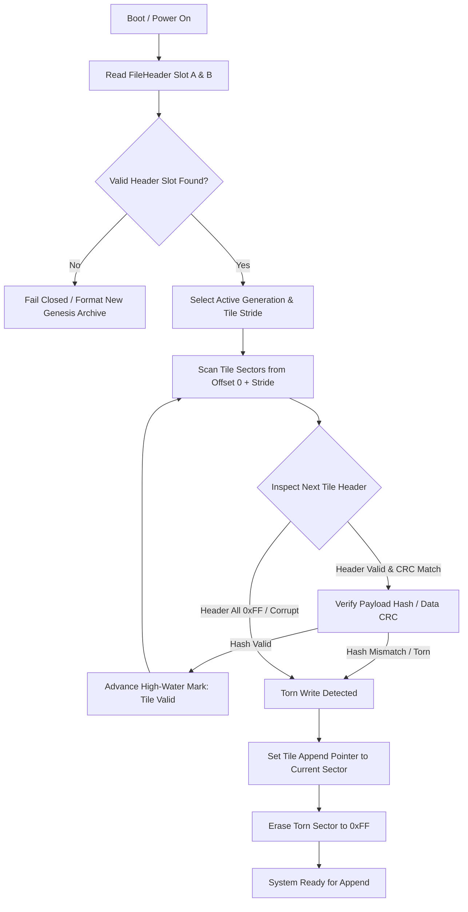
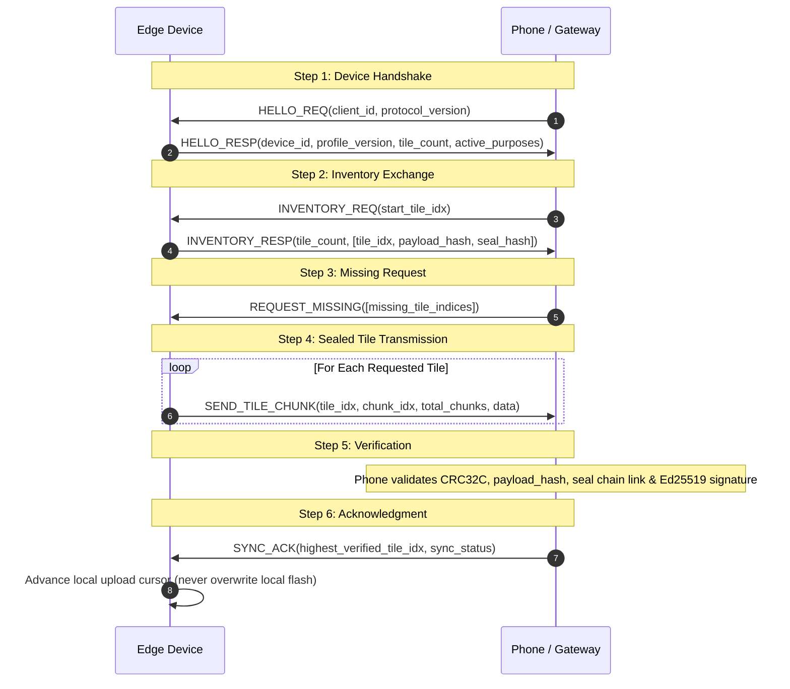

# S3A Edge Profile Specification (S3A-EDGE-PROFILE)

**Document Version:** 1.1-draft  
**Status:** IMPLEMENTED (Phase 1: Device-Side Writer)  
**Date:** October 2026  
**License:** [Creative Commons Attribution 4.0 International (CC-BY-4.0)](LICENSE)  
**Patents:** [Royalty-Free Patent Non-Assertion Pledge](PATENTS.md)  
**Parent Specification:** [S3A Hyper-Tile Storage Format Specification](S3A-TILE-SPEC.md)

**Changelog:**
- **v1.1-draft (October 2026)**: §2.4.1 now documents `data_crc32` (12..16), `header_crc32` (56..60) and `generation` (60..64) as written by the reference code, replacing the stale reserved-byte rows and the §14.4 discrepancy note (ADR-0003). No on-disk bytes change.

---

## Specification Audit & Implementation Notice

> [!NOTE]
> **SPECIFICATION AUDIT STATUS: IMPLEMENTED (Phase 1: Device-Side Writer)**  
> In accordance with S3A Specification Audit Policy, Phase 1 (the `#![no_std]` device-side writer, `FlashStorage` SPI NOR abstraction, power-loss crash safety, delta bit-packing, cryptographic SHA-256 seal chain, Ed25519 hardware signatures, and lossless `s3a-engine` interop) is **FULLY IMPLEMENTED** and verified across `crates/s3a-edge`, `crates/s3a-core`, `crates/s3a-engine`, and `crates/s3a-spec-vectors`.
> All 228 workspace tests pass 100% green. Conformance vectors `MICRO-VEC-01`, `MICRO-VEC-02`, and `MICRO-VEC-03` are generated and verified. Phase 2 (mobile transport/BLE GATT client) remains specified for subsequent delivery.

---

## 1. Conformance, Terminology & Core Invariants

The key words **"MUST"**, **"MUST NOT"**, **"REQUIRED"**, **"SHALL"**, **"SHALL NOT"**, **"SHOULD"**, **"SHOULD NOT"**, **"RECOMMENDED"**, **"NOT RECOMMENDED"**, **"MAY"**, and **"OPTIONAL"** in this document are to be interpreted as described in BCP 14 [RFC 2119] [RFC 8174].

### 1.1 Architectural Scope

The S3A Edge Profile governs resource-constrained microcontrollers, embedded sensors, industrial telemetry loggers, and wearable hardware operating under tight physical limitations:
- **Available System RAM**: $\le 32\text{ KB}$ SRAM.
- **Storage Substrate**: SPI NOR Flash, QSPI Flash, raw EEPROM, or internal MCU Flash with physical sectors (typically 4 KB sector erase, 256-byte page programming).
- **Execution Environment**: `no_std`, heapless (zero dynamic heap allocation: zero `malloc`, zero `alloc::vec::Vec`, zero `Box`), fixed stack and static buffers.
- **Microcontroller Classes**: Espressif ESP32 / ESP32-C3 / ESP32-S3, Nordic Semiconductor nRF52832 / nRF52840, Raspberry Pi RP2040 / RP2350, and STMicroelectronics STM32 (Cortex-M0+/M3/M4/M33).

### 1.2 Core Invariant: Full Engine Readability

> **PRIMARY ARCHITECTURAL INVARIANT**:  
> Every S3A file produced by an edge device **MUST remain a valid S3A file directly readable by the full S3A storage engine (`s3a-core` / `s3a-engine`)**.  
> Ingestion of an edge archive into desktop, server, or cloud runtimes MUST NOT require format transcoding, destructive reformatting, or loss of cryptographic provenance.

---

## 2. Micro-Tile Profile Framing & Headers

Standard S3A archives (§2 of `S3A-TILE-SPEC.md`) partition data into 128 KB (131,072 bytes) Hyper-Tiles with 512-byte headers. Because 128 KB exceeds the total physical SRAM of target microcontrollers, the Edge Profile defines **Micro-Tiles**.

### 2.1 Micro-Tile Physical Stride & Alignment

1. **Declared Tile Stride**: Micro-Tiles MUST have a fixed physical stride of either:
   - **4 KB Profile**: Exactly $4,096\text{ bytes}$ ($2^{12}\text{ bytes}$).
   - **8 KB Profile**: Exactly $8,192\text{ bytes}$ ($2^{13}\text{ bytes}$).
2. **Flash Page Alignment**: Micro-Tile boundaries MUST be strictly aligned to hardware flash sector erase blocks (typically 4,096 bytes on SPI NOR flash). Writers MUST NOT span a single micro-tile across non-aligned flash sectors.
3. **Stride Declaration**: The physical tile stride MUST be declared in the archive header, allowing readers to compute tile offsets directly.

```
Standard Hyper-Tile Archive:
+-------------------+--------------------------+--------------------------+
| Header (512 B)    | Hyper-Tile 0 (128 KB)    | Hyper-Tile 1 (128 KB)    |
+-------------------+--------------------------+--------------------------+

Edge Micro-Tile Archive (4 KB Stride):
+-------------------+--------------------+--------------------+-----------+
| Header (512 B / C)| Micro-Tile 0 (4 KB)| Micro-Tile 1 (4 KB)| ...       |
+-------------------+--------------------+--------------------+-----------+
```

### 2.2 File Header Declaration & Flags

To maintain 100% interoperability with the full engine, edge files use the standard 64-byte `FileHeader` layout, utilizing the existing `flags` field (offset 6..8) and `_reserved1` field (offset 20..24).

#### 2.2.1 FileHeader Field Layout in Edge Profile
| Byte Offset | Type | Field Name | Semantics in Edge Profile |
|:---:|:---:|:---|:---|
| `0 .. 4` | `[u8; 4]` | `magic` | MUST be ASCII bytes `b"S3A1"` (`0x53, 0x33, 0x41, 0x31`). |
| `4 .. 6` | `u16` | `version` | MUST be `1`. |
| `6 .. 8` | `u16` | `flags` | Archive feature flags: bitmask declaring profile and header format (§2.2.2). |
| `8 .. 16` | `u64` | `generation` | Monotonically increasing commit counter. |
| `16 .. 20` | `u32` | `tile_count` | Number of committed Micro-Tiles. |
| `20 .. 24` | `u32` | `tile_stride` | Physical tile size in bytes: `4096` or `8192`. (Standard engine reads `0` as 131,072). |
| `24 .. 32` | `u64` | `created_timestamp` | Archive creation timestamp (Unix epoch seconds). |
| `32 .. 40` | `u64` | `commit_timestamp` | Timestamp of latest tile commit (Unix epoch seconds). |
| `40 .. 44` | `u32` | `header_crc32` | Castagnoli CRC32C over bytes `0..40` concatenated with `44..64`. |
| `44 .. 48` | `u32` | `addon_mask` | MUST include `0x0008` (`ADDON_WEARABLE` / Edge). |
| `48 .. 64` | `[u64; 2]` | `file_uuid` | 128-bit unique file UUID for self-addressing validation. |

#### 2.2.2 Archive Flags Bitmask (`FileHeader.flags`)
- **`FLAG_PROFILE_EDGE = 1 << 0` (`0x0001`)**: Identifies this archive as an Edge Micro-Tile container.
- **`FLAG_TILE_SIZE_4KB = 1 << 1` (`0x0002`)**: Explicit flag indicating 4,096-byte tile stride.
- **`FLAG_TILE_SIZE_8KB = 1 << 2` (`0x0004`)**: Explicit flag indicating 8,192-byte tile stride.
- **`FLAG_COMPACT_HEADER = 1 << 3` (`0x0008`)**: Set if the file uses the Compact File Header variant (§2.3.2) instead of the standard 512-byte DualFileHeader.
- **`FLAG_SEAL_CHAIN_ACTIVE = 1 << 4` (`0x0010`)**: Indicates tiles maintain an on-device cryptographic seal hash chain.
- **`FLAG_ED25519_SIGNED = 1 << 5` (`0x0020`)**: Indicates seals contain valid Ed25519 hardware signatures.

### 2.3 File Header Framing Variants

Edge devices MAY format the start of the archive file using either of two framing variants:

#### 2.3.1 Variant A: Standard Dual-Slot File Header (512 Bytes) — RECOMMENDED
- **Layout**: Exactly 512 bytes: Slot A (64 B, offset 0..64), Slot B (64 B, offset 64..128), and 384 zero padding bytes (offset 128..512).
- **Physical Alignment**: Perfectly aligns with standard 512-byte storage sectors (SD cards, USB MSC, FATFS, LittleFS).
- **Engine Compatibility**: 100% native bit-compatibility with existing `s3a-engine::DualFileHeader`.
- **Tile Offsets**: Tile $i$ resides at absolute byte offset:
  $$\text{Offset}(i) = 512 + (i \times \text{tile\_stride})$$

#### 2.3.2 Variant B: Compact File Header (Flash-Page Aligned)
- **Motivation**: On raw SPI NOR flash without filesystem emulation, dedicating 512 bytes for a header where sector erase blocks are 4 KB may waste a full sector.
- **Layout**:
  - Single Slot: Slot A (64 bytes) at offset 0, followed by $(P - 64)$ zero bytes where $P$ is the minimum hardware programming page size (typically 256 bytes or 4,096 bytes).
  - Dual Slot Compact: Slot A (64 B) at 0..64, Slot B (64 B) at 64..128, padded to page size $P$.
- **Flags**: `FileHeader.flags` MUST have `FLAG_COMPACT_HEADER` (`0x0008`) set.
- **Engine Compatibility Bridge**: Full engine readers inspecting an archive check `FLAG_COMPACT_HEADER`. If set, the header extent is $P = \max(256, \text{tile\_stride})$ and tiles are read from $\text{Offset}(i) = P + (i \times \text{tile\_stride})$.
- **Edge detection**: an archive is an Edge archive, with 64-byte Common Tile Headers (§2.4.1) at each stride, when `FLAG_PROFILE_EDGE` is set **or** `tile_stride` is 4096 or 8192. The `FLAG_TILE_SIZE_*` bits are informational; `tile_stride` decides the stride. Bytes after the last committed tile (for example a torn partial tile) are ignored.

### 2.4 Tile Header Encodings

Every Micro-Tile starts with a header defining its type, record count, and integrity hashes. Edge implementations MUST use one of the two formats below:

#### 2.4.1 Canonical 64-Byte Common Tile Header (Lossless Native)
The canonical edge tile header is identical in byte layout to the 64-byte Common Tile Header defined in §14.1 of `S3A-TILE-SPEC.md`. All multi-byte integers are little-endian. Offsets are verified by `crates/s3a-edge/tests/header_layout.rs` (ADR-0003):

| Offset | Size | Type | Field Name | Description |
|:---:|:---:|:---:|:---|:---|
| `0 .. 2` | 2 B | `u16` | `type_id` | Canonical wire tile type ID (e.g. 64, 70, 71, 75). |
| `2 .. 4` | 2 B | `u16` | `type_version` | Record schema layout version (1-based, starts at 1). |
| `4 .. 6` | 2 B | `u16` | `flags` | Tile flags (`FLAG_ACTIVE = 0`, `FLAG_SEALED = 1`, `FLAG_CRC_CHAIN = 2`). |
| `6 .. 8` | 2 B | `u16` | `_reserved1` | Reserved. Writers MUST write 0; readers MUST ignore the value. |
| `8 .. 12` | 4 B | `u32` | `record_count` | Number of logical records contained in payload. |
| `12 .. 16` | 4 B | `u32` | `data_crc32` | CRC32C (Castagnoli) over the active payload bytes `[64 .. 64 + payload_len)`. |
| `16 .. 24` | 8 B | `u64` | `payload_len` | Byte length of active payload ($0 \le \text{payload\_len} \le \text{tile\_stride} - 64$). |
| `24 .. 56` | 32 B | `[u8; 32]` | `payload_hash` | SHA-256 digest over active payload bytes. |
| `56 .. 60` | 4 B | `u32` | `header_crc32` | CRC32C over header bytes `0..56` concatenated with `60..64` (this field skipped). |
| `60 .. 64` | 4 B | `u32` | `generation` | Commit generation of the archive when this tile was sealed (low 32 bits of the file-header `generation`). |

- **Integrity rules**:
  - Writers MUST set `data_crc32`, `header_crc32` and `generation` on every sealed tile, and the reference writer sets `TILE_FLAG_CRC_CHAIN` (`flags` bit value `2`) alongside `TILE_FLAG_SEALED` (`1`).
  - When `TILE_FLAG_CRC_CHAIN` is set, desktop/full-engine readers SHOULD verify `header_crc32` and `data_crc32` and treat a mismatch as a torn or corrupt tile. Edge recovery (§4) MUST verify them. *Note: the current reference engine (`s3a-engine` `get_edge_tile`) does not yet verify them; tracked for Phase A3.*
  - `header_crc32 == 0` means the header is unsealed/invalid (`CommonTileHeader::verify` returns false).
  - Vectors: `spec-vectors/hashes/edge_data_crc32c.json`, `edge_header_crc32c.json`.
- **Capacities**:
  - In a 4 KB micro-tile: Max payload = $4,096 - 64 = 4,032\text{ bytes}$.
  - In an 8 KB micro-tile: Max payload = $8,192 - 64 = 8,128\text{ bytes}$.

#### 2.4.2 Ultra-Compact 32-Byte Tile Header Variant
For ultra-low power 8-bit/16-bit or severely RAM-constrained MCUs, an ultra-compact 32-byte header is permitted:

| Offset | Size | Type | Field Name | Semantics |
|:---:|:---:|:---:|:---|:---|
| `0 .. 2` | 2 B | `u16` | `type_id` | Canonical tile type ID. |
| `2 .. 3` | 1 B | `u8` | `type_version` | Layout version ($1..255$). |
| `3 .. 4` | 1 B | `u8` | `flags` | Tile flags (`0x01` sealed, `0x02` compressed). |
| `4 .. 6` | 2 B | `u16` | `record_count` | Number of records ($0..65,535$). |
| `6 .. 8` | 2 B | `u16` | `payload_len` | Payload bytes ($0 \le \text{len} \le 8,160$). |
| `8 .. 12` | 4 B | `u32` | `data_crc32` | Castagnoli CRC32C over active payload bytes. |
| `12 .. 16` | 4 B | `u32` | `header_crc32` | Castagnoli CRC32C over bytes `0..12` concatenated with `16..32`. |
| `16 .. 32` | 16 B | `[u8; 16]` | `payload_hash_prefix`| Leading 16 bytes of SHA-256 payload digest (or truncated BLAKE3). |

#### 2.4.3 Lossless Promotion Mapping to Full Engine
When a file using the Ultra-Compact 32-byte Tile Header is ingested by the full engine, it maps losslessly to the canonical 64-byte Common Tile Header and 512-byte `HyperTileHeader`:
1. `type_id`: `u16` $\to$ zero-extended to `u32`.
2. `type_version`: `u8` $\to$ zero-extended to `record_layout_version` (`u32`).
3. `record_count`: `u16` $\to$ zero-extended to `record_count` (`u32`).
4. `payload_len`: `u16` $\to$ zero-extended to `payload_bytes` (`u32`).
5. `data_crc32`: Direct 1:1 assignment to `HyperTileHeader.data_crc32`.
6. Full 32-byte `payload_hash` is computed on the host CPU over the payload bytes and verified against `payload_hash_prefix`.

---

## 3. Device Constraints & Heapless Execution Model

### 3.1 Heapless Operation (`no_std`)

The S3A Edge Profile is designed to execute under `#![no_std]` without requiring an operating system, dynamic allocator (`alloc`), or POSIX runtime:
1. **Zero Allocations**: Writers and readers MUST NOT invoke dynamic heap allocation routines (`malloc`, `free`, `realloc`, `Box::new`, `Vec::push`).
2. **Deterministic Memory Footprint**: All state structures MUST reside in static memory or on the call stack.
3. **RAM Ceiling**: The entire S3A Edge engine state, including working page buffers, MUST fit within:
   $$\text{RAM Usage} \le 4.5\text{ KB}$$
   This leaves $\ge 27.5\text{ KB}$ of RAM free for networking stacks (Bluetooth LE, LoRa, Wi-Fi) on a 32 KB microcontroller.

### 3.2 Fixed Buffer Allocation Model

An edge device maintains exactly two fixed buffers in memory:

```
+---------------------------------------------------------------+
| SRAM Memory Layout (<= 4.5 KB)                                |
|   +---------------------------------------------------------+ |
|   | Active Tile Page Staging Buffer: 4,096 Bytes            | |
|   | (Holds in-progress micro-tile before sealing to flash)  | |
|   +---------------------------------------------------------+ |
|   | State & Hash Context Workspace: 256 Bytes               | |
|   | (Running CRC32C, SHA-256 state, Ed25519 temp keys)      | |
|   +---------------------------------------------------------+ |
|   | Call Stack Depth: <= 256 Bytes                          | |
+---------------------------------------------------------------+
```

### 3.3 Append + Seal Only Flash Paradigm

Flash memory physics dictate that individual bits can transition from `1` to `0` upon programming, but clearing `0` back to `1` requires erasing an entire physical sector (typically 4 KB).
1. **No In-Place Overwrites**: An edge device MUST NEVER update, modify, or rewrite already programmed flash memory words.
2. **Append-Only Record Streaming**: Records are staged in the RAM buffer or written sequentially to erased flash pages.
3. **Seal Finalization**: Once a micro-tile reaches capacity or a configured flush interval expires, the tile is finalized ("sealed") by programming its header and cryptographic seal. Once sealed, the tile is immutable.

---

## 4. Power-Loss Safety & Atomic Recovery

Edge devices are deployed in hostile environments subject to abrupt power loss, battery exhaustion, brownouts, and physical disconnects. S3A Edge Profile enforces strict crash consistency.

### 4.1 Atomicity Invariant

> **THE COMPLETION INVARIANT**:  
> A Micro-Tile is either **100% complete and validated**, or it is **ignored**.  
> Partially written, torn, or unsealed micro-tiles MUST NEVER be interpreted as valid committed history.

### 4.2 Two-Phase Sector Commit Protocol

To guarantee crash resilience on raw flash without write-ahead logging (WAL), the edge firmware writes each micro-tile in two distinct phases:

```
Phase 1: Sector Erase & Payload Programming
Flash Sector: [ 64B Uncommitted Header (0xFF) | ... Valid Payload Records ... | Free 0xFF ]

Phase 2: Header Seal Finalization
Flash Sector: [ 64B Valid Header (CRC Valid)  | ... Valid Payload Records ... | Zero Padding ]
```

1. **Step 1: Sector Erase**: The target 4 KB flash sector is erased (all bytes `0xFF`).
2. **Step 2: Incremental Payload Streaming**: Payload records are appended into flash pages starting at offset 64 (or 32). The header block (offset 0..64) remains unwritten (all bytes `0xFF`).
3. **Step 3: Atomic Seal Finalization**:
   - The device computes the active `payload_len`, `record_count`, `data_crc32`, and SHA-256 `payload_hash`.
   - The device constructs the 64-byte (or 32-byte) tile header and computes `header_crc32`.
   - The header is programmed into the first flash page (offset 0).
   - Once the header programming succeeds, the tile is atomically committed.

### 4.3 Per-Record Integrity Protection

Where records are appended sequentially across extended intervals before tile sealing:
1. Every record structure MUST include an inline Castagnoli CRC32C field protecting that record's payload.
2. A reader encountering an unsealed tile during boot recovery inspects records sequentially. Any record with an invalid CRC32C or all `0xFF` bytes indicates the point of power failure.

### 4.4 Boot-Time Recovery State Machine

Upon microcontroller boot or reset, the firmware executes the following state machine before accepting new sensor data or servicing network queries:



1. **Header Arbitration**: Read Slot A and Slot B from the archive header. Verify CRC32C. Select the slot with the highest valid generation counter.
2. **Sequential Tile Verification**:
   - Compute physical offset $\text{Offset}(i) = \text{HeaderExtent} + (i \times \text{tile\_stride})$.
   - Read tile header. If the entire header is `0xFF`, the end of committed data has been reached cleanly.
   - If header bytes are populated, verify `header_crc32`. If the checksum fails, the header was torn mid-write.
   - Read payload bytes and verify `data_crc32` or `payload_hash`. If verification fails, the payload was torn.
3. **Recovery Action**:
   - Set the active append index $i$ to the first uncommitted, torn, or erased sector.
   - Erase the torn sector back to `0xFF` to clear any partial byte corruption.
   - Update `FileHeader.tile_count` to match the count of fully valid tiles preceding the torn sector.

---

## 5. Record Encodings for Edge Devices

Edge telemetry captures continuous sensor observations, industrial equipment lifecycle events, and small configuration snapshots. All records are plain-old-data (Pod) structs aligned to 4-byte or 8-byte boundaries.

### 5.1 Monotonic Time-Series Encoding (`time-series`, Type ID: `75` / `0x004B`)

Sensor telemetry (temperatures, vibrations, currents, IMU, PPG) is encoded using monotonic time deltas and quantized bit-packing to maximize storage density without dynamic memory allocation.

#### 5.1.1 Compact Sensor Record (16 Bytes, 4-Byte Aligned)
```rust
#[repr(C, align(4))]
pub struct CompactEdgeSensorRecord {
    pub delta_ts_ms: u16,   // Delta milliseconds from tile min_timestamp
    pub sensor_id: u8,      // Physical sensor channel (0..255)
    pub metric_id: u8,      // Metric type (e.g., 1=Temp, 2=Vibration, 3=Current)
    pub quantized_val: i32, // Fixed-point value (scale factor defined in config)
    pub quality_flags: u16, // Hardware status: 0=OK, 1=Clipped, 2=Degraded
    pub record_crc16: u16,  // CCITT CRC16 over preceding 14 bytes
}
```

#### 5.1.2 Delta + Bit-Packing Encoding Rules
1. **Delta Timestamps**: The micro-tile header records `min_timestamp` (Unix epoch seconds or milliseconds). Individual records encode $\Delta t = t_{\text{record}} - \text{min\_timestamp}$ as a 16-bit unsigned integer, providing up to 65,535 ms (65.5 seconds) of range per tile at 1 ms resolution.
2. **Frame-of-Reference (FoR) Quantization**: Continuous physical floating-point measurements $V$ are converted to integers via:
   $$Q = \text{round}\left(\frac{V - \text{base\_offset}}{\text{scale\_step}}\right)$$
   Where `base_offset` and `scale_step` are declared in the tile header or a configuration snapshot tile.

### 5.2 Industrial Equipment Event Log Records (`record`, Type ID: `64` / `0x0040`)

Industrial machinery (pumps, compressors, CNC spindles, robotics) records discrete operational milestones, alarms, and operator interactions.

#### 5.2.1 EquipmentEventRecord (32 Bytes, 8-Byte Aligned)
| Offset | Type | Field Name | Description |
|:---:|:---:|:---|:---|
| `0 .. 8` | `u64` | `timestamp_sec` | Absolute Unix epoch timestamp of event. |
| `8 .. 10` | `u16` | `event_type` | Event category (§5.2.2). |
| `10 .. 11` | `u8` | `severity` | Severity level ($0 = \text{Info}$, $1 = \text{Warn}$, $2 = \text{Alarm}$, $3 = \text{Emergency}$). |
| `11 .. 12` | `u8` | `subsystem_id` | Physical component / module index ($0..255$). |
| `12 .. 16` | `u32` | `event_code` | Manufacturer fault code / status identifier. |
| `16 .. 24` | `[u8; 8]` | `operator_id` | NFC/RFID badge ID, operator identifier, or tool ID. |
| `24 .. 28` | `i32` | `param1` | Event contextual parameter (e.g., RPM, pressure, error code). |
| `28 .. 32` | `u32` | `record_crc32` | Castagnoli CRC32C over bytes `0..28`. |

#### 5.2.2 Canonical Equipment Event Categories (`event_type`)
- `0x0001` — `EVENT_MACHINE_START`: Machine motor or power stage energized.
- `0x0002` — `EVENT_MACHINE_STOP`: Controlled process shutdown.
- `0x0003` — `EVENT_EMERGENCY_STOP`: Physical E-stop or safety curtain trip.
- `0x0004` — `EVENT_FAULT_CODE`: Overcurrent, thermal trip, or sensor loss.
- `0x0005` — `EVENT_MAINTENANCE`: Scheduled lubrication, filter replacement, or inspection.
- `0x0006` — `EVENT_CALIBRATION`: Zero-point adjustment, scale tare, or sensor trim.
- `0x0007` — `EVENT_OPERATOR_CHANGE`: Operator badge login, logout, or shift handover.

### 5.3 Small Key-Value Configuration Snapshots (`schema` / `config`)

To ensure files remain fully self-describing, devices emit a configuration snapshot tile upon boot, parameter adjustment, or calibration.

#### 5.3.1 ConfigEntryRecord (32 Bytes, 4-Byte Aligned)
```rust
#[repr(C, align(4))]
pub struct ConfigEntryRecord {
    pub key: [u8; 16],      // Null-terminated ASCII key (e.g. "sample_hz\0", "temp_scale\0")
    pub val_type: u16,      // 1=i32, 2=u32, 3=f32, 4=bool, 5=raw_bytes8
    pub _pad: u16,          // Alignment padding
    pub val_bytes: [u8; 8], // Little-endian representation of value
    pub record_crc32: u32,  // Castagnoli CRC32C over bytes 0..28
}
```

---

## 6. Trust Architecture, Device Identity & Sealing

Edge devices establish tamper evidence directly at the physical point of data capture. Because low-power microcontrollers lack direct internet access and Bitcoin consensus headers, trust is split into **On-Device Sealing** and **Upstream Anchoring**.

### 6.1 On-Device Seal Hash Chain

Each Micro-Tile is cryptographically linked to its predecessor via an on-device SHA-256 seal chain:

$$\text{seal\_hash}_n = \text{SHA-256}(b"\text{S3AEDGE1}" \parallel \text{prev\_seal\_hash} \parallel \text{generation}_n \parallel \text{tile\_index}_n \parallel \text{payload\_hash}_n \parallel \text{device\_id})$$

1. **Genesis Rule**: For the first tile written by a freshly provisioned device, `prev_seal_hash` MUST equal 32 all-zero bytes (`[0u8; 32]`).
2. **Chain Continuity**: For every subsequent tile $n$, `prev_seal_hash` MUST strictly equal $\text{seal\_hash}_{n-1}$.
3. **Reader Verification**: A reader traversing the archive recomputes each link. Any modified, inserted, or reordered tile breaks the chain immediately (`S3AError::SealedChainBreak`).

### 6.2 Per-Device Ed25519 Signatures

Where hardware cryptographic accelerators (e.g., ESP32 RSA/ECC accelerator, nRF52 CC310 CryptoCell, ATECC608 secure element) or optimized software libraries (`ed25519-compact`) are present:
1. **Device Private Key**: A unique 32-byte Ed25519 private key is injected or generated in secure hardware during factory provisioning.
2. **Signature Computation**: Upon finalizing a micro-tile, the device signs the 32-byte `seal_hash`:
   $$\sigma_n = \text{Ed25519\_Sign}(\text{PrivKey}_{\text{device}}, \text{seal\_hash}_n)$$
3. **Storage**: The 64-byte signature is embedded in a dedicated Cryptographic Seal Tile (`seal`, Type ID: `70` / `0x0046`) or appended directly into the micro-tile seal extension.

### 6.3 Device Identity Record

Every Edge S3A archive MUST contain at least one `DeviceIdentityRecord` (written in Tile 0 or alongside genesis provisioning):

#### 6.3.1 DeviceIdentityRecord Layout (96 Bytes, 8-Byte Aligned)
| Offset | Type | Field Name | Description |
|:---:|:---:|:---|:---|
| `0 .. 16` | `[u8; 16]` | `device_id` | Unique 128-bit hardware UUID / IEEE EUI-64 + zero padding. |
| `16 .. 32` | `[u8; 16]` | `hardware_model` | Null-terminated UTF-8 model string (e.g. `b"PUMP-SENS-V2\0"`). |
| `32 .. 40` | `[u16; 4]` | `firmware_version`| Semver integer tuple: `[major, minor, patch, build]`. |
| `40 .. 72` | `[u8; 32]` | `public_key` | 32-byte Ed25519 device public key. |
| `72 .. 80` | `u64` | `provisioned_at` | Unix epoch timestamp of factory commissioning. |
| `80 .. 88` | `u64` | `boot_count` | Monotonic non-volatile MCU boot counter. |
| `88 .. 92` | `u32` | `_reserved` | Alignment padding (MUST be 0). |
| `92 .. 96` | `u32` | `record_crc32` | Castagnoli CRC32C over bytes `0..92`. |

### 6.4 Upstream Anchoring (OTS / RFC 3161) Delegation

Edge devices DO NOT submit timestamps to public Bitcoin calendars or Timestamp Authorities directly. Instead:
1. The edge device preserves its immutable, signed seal hash chain on local flash.
2. When a phone, edge gateway, or server pulls the edge archive, the upstream reader computes the canonical archive fingerprint (§11.1 of `S3A-TILE-SPEC.md`).
3. The upstream reader submits the fingerprint to OpenTimestamps (OTS) calendars and RFC 3161 Timestamp Authorities.
4. The resulting Merkle proofs are attached to the archive footer in the `ANCHORS` extension slice (`b"ANCHORS\0"`).
5. **Result**: The edge device's physical sensor readings obtain globally verifiable, mathematically binding chronological proof on the Bitcoin blockchain without the microcontroller expending network energy or memory.

---

## 7. Consent & Ownership Governance

In accordance with S3A Trust Principles, data sovereignty and privacy boundaries are committed directly to the physical storage media at the device edge.

### 7.1 Provisioning Consent Tile (`consent`, Type ID: `71` / `0x0047`)

At commissioning (factory setup or installation via phone app), an initial **Consent & Ownership Tile** is written to the device archive:

#### 7.1.1 EdgeConsentRecord Layout (64 Bytes, 8-Byte Aligned)
| Offset | Type | Field Name | Description |
|:---:|:---:|:---|:---|
| `0 .. 16` | `[u8; 16]` | `owner_uuid` | Pseudonymized 128-bit participant or enterprise owner UUID. |
| `16 .. 20` | `u32` | `allowed_purposes`| Bitmask declaring authorized data processing purposes (§7.1.2). |
| `20 .. 24` | `u32` | `sharing_scope` | Bitmask declaring which tile types MAY be shared (§7.1.3). |
| `24 .. 32` | `u64` | `granted_at` | Unix epoch seconds when consent was granted. |
| `32 .. 40` | `u64` | `expires_at` | Unix epoch expiration timestamp ($0 = \text{Indefinite}$). |
| `40 .. 48` | `u64` | `admin_actor_id` | Identifier of authorized technician / owner performing provisioning. |
| `48 .. 52` | `u32` | `consent_version` | Schema version ($1$). |
| `52 .. 56` | `u32` | `_reserved` | Reserved zero padding. |
| `56 .. 60` | `u32` | `record_crc32` | Castagnoli CRC32C over bytes `0..56`. |
| `60 .. 64` | `u32` | `_pad` | Alignment padding to 64 bytes. |

#### 7.1.2 Allowed Purposes Bitmask (`allowed_purposes`)
- `0x0001` — `PURPOSE_OPERATIONAL_MAINTENANCE`: Predictive maintenance and health monitoring.
- `0x0002` — `PURPOSE_SAFETY_AUDIT`: Incident investigation and E-stop logging.
- `0x0004` — `PURPOSE_RESEARCH_ANALYTICS`: Anonymized longitudinal scientific research.
- `0x0008` — `PURPOSE_MODEL_TRAINING`: Machine learning model training (strictly opt-in).
- `0x0010` — `PURPOSE_THIRD_PARTY_SHARING`: Transmission to external contractors or partners.

#### 7.1.3 Sharing Scope Bitmask (`sharing_scope`)
- `0x0001` — `SCOPE_TELEMETRY`: Raw high-frequency time-series sensor data.
- `0x0002` — `SCOPE_EQUIPMENT_FAULTS`: Error codes and emergency stop records.
- `0x0004` — `SCOPE_CALIBRATION_LOGS`: Sensor calibration parameters and offsets.
- `0x0008` — `SCOPE_OPERATOR_IDENTITY`: Operator badge IDs and shift identifiers.

### 7.2 Immutable Append-Only Consent Updates

1. **Non-Destructive Governance**: Existing consent records on the device MUST NEVER be edited or erased in place.
2. **Consent Evolution**: If the owner revokes consent, alters sharing scopes, or extends expiration dates, a new `EdgeConsentRecord` is appended to the next active micro-tile.
3. **Precedence**: The active consent policy is governed by the highest-index valid consent record committed in the archive.

---

## 8. Transport-Agnostic Sharing Protocol

Edge devices share their sealed micro-tiles with other devices (peer-to-peer), mobile phones, or gateway servers over diverse physical channels: Bluetooth Low Energy (BLE), Wi-Fi SoftAP, USB CDC serial, UART, or LoRa/LoRaWAN.

### 8.1 Transport Independence & Framing

All communication uses a uniform, transport-agnostic framing packet:

```
+---------------------------------------------------------------+
| S3A Wire Frame (Variable Length, Max 512 B or MTU Aligned)    |
|   Magic: ASCII b"S3AP" (4 Bytes)                              |
|   Message Type: u16 (2 Bytes)                                 |
|   Sequence ID: u16 (2 Bytes)                                  |
|   Payload Length: u16 (2 Bytes)                               |
|   Payload Data: Variable (0 .. 500 Bytes)                     |
|   Frame CRC32C: u32 (4 Bytes, over Magic through Payload)     |
+---------------------------------------------------------------+
```

- **BLE Adaptation**: Packets are chunked across Bluetooth ATT MTU boundaries (negotiated MTU 247 bytes; S3A chunks of 240 bytes).
- **LoRa Adaptation**: Large tile payloads are divided into 50-byte fragments with monotonic block sequence headers and reassembly masks.

### 8.2 Six-Step Synchronization Handshake

The sharing session adheres to a strictly deterministic six-step handshake:



#### 8.2.1 Protocol Step Details
1. **`HELLO`**: Initiates session. Device returns its `device_id`, firmware version, active `tile_count`, and active consent `allowed_purposes`.
2. **`TILE_INVENTORY`**: The receiver requests the list of committed tile hashes. The device responds with an array of `(tile_index, payload_hash, seal_hash)` tuples.
3. **`REQUEST_MISSING`**: The receiver inspects its local archive, skips tiles whose hashes it already holds (deduplication), and requests only missing tiles.
4. **`SEND_SEALED_TILES`**: The device transmits the requested micro-tiles in sequential chunks.
5. **`VERIFY`**: The receiver reassembles each micro-tile, verifies `header_crc32`, recomputes `payload_hash`, verifies the hash chain against `prev_seal_hash`, and validates the Ed25519 signature.
6. **`ACK`**: The receiver transmits a signed or CRC-protected `SYNC_ACK`. The device updates its non-volatile sync cursor.

### 8.3 Invariants of the Sharing Protocol
1. **Consent Gating**: The edge device MUST evaluate the active `sharing_scope` before transmitting any tile. If a tile contains records not authorized by the current consent record (e.g. `SCOPE_OPERATOR_IDENTITY` revoked), the device MUST omit that tile and return `ERR_CONSENT_RESTRICTED`.
2. **No Overwrites**: Synchronization is strictly additive. An edge device NEVER accepts overwrite commands for previously sealed tiles.
3. **Resumability**: If a BLE or serial connection drops mid-transfer, the subsequent session resumes from the last unacknowledged tile index.

---

## 9. Archive Merge & Promotion Rules

When edge micro-tiles are pulled by a phone, edge gateway, or server, they are frequently merged into a consolidated master S3A database or multi-device research archive.

### 9.1 Conflict-Free Invariant

> **THE CONFLICT-FREE GUARANTEE**:  
> Because S3A files are strictly append-only and all records are keyed by immutable `(device_id, tile_index, timestamp)` tuples, **write-write conflicts between edge devices are mathematically impossible**.

### 9.2 Provenance Preservation Rules

When merging edge micro-tiles into a full S3A archive:
1. **Identity Retention**: Every merged tile retains its originating `device_id` and initial generation stamp in its metadata record or provenance wrapper (`provenance`, Type ID: `72` / `0x0048`).
2. **Seal Chain Continuity**: The on-device seal hash chain MUST NOT be rewritten or discarded. The original chain is preserved as an embedded provenance proof, ensuring the edge data remains verifiable back to the physical microcontroller hardware.
3. **Idempotent Deduplication**: If an edge device synchronizes the same micro-tiles multiple times, the merge engine identifies existing tiles by their canonical SHA-256 `payload_hash` and silently skips duplicates.

---

## 10. Phone Reader App Requirements (Android First)

To operationalize the Edge Profile, mobile reader applications (targeting Android first, with cross-platform desktop/iOS architectures) MUST satisfy the following functional requirements:

### 10.1 Physical Transports & Connectivity
- **BLE Central Role**: Implement Android BLE scanning (`BluetoothLeScanner`) and GATT client (`BluetoothGattCallback`) with automatic MTU negotiation to $\ge 247\text{ bytes}$.
- **USB Host Mode**: Support USB-OTG serial communication via Android USB Host API (`UsbManager`, `UsbDeviceConnection`) using standard CDC-ACM, FTDI, and CP210x drivers.
- **Wi-Fi SoftAP**: Connect to device-hosted HTTP/WebSocket endpoints on local subnets.

### 10.2 Cryptographic Verification Pipeline
1. **Native CRC32C**: Compute hardware-accelerated Castagnoli CRC32C over all received headers and payload chunks.
2. **SHA-256 Payload Validation**: Verify that the calculated SHA-256 digest of reassembled payload bytes matches `payload_hash`.
3. **Chain Continuity Audit**: Verify `seal_hash` continuity across all synchronized tiles back to genesis.
4. **Ed25519 Signature Verification**: Validate the device signature against the cached or provisioned `public_key`. Corrupt signatures MUST trigger immediate user alerts and archive quarantine.

### 10.3 Offline Storage & Visualization
1. **Offline-First Cache**: Received tiles MUST be stored locally on the phone in raw `.s3a` format within protected app storage (`getExternalFilesDir`).
2. **Telemetry Dashboard**: Render real-time and historical sensor graphs (temperature trends, vibration FFT, battery health).
3. **Event Timeline**: Display color-coded equipment event logs (faults in red, maintenance in yellow, normal operations in green).

### 10.4 Upstream Synchronization to Learning Record Stores (LRS)
1. **xAPI Statement Transformation**: The phone app transforms equipment events and operator activities into standard xAPI 1.0.3 statements:
   - *Actor*: Operator badge ID or device UUID.
   - *Verb*: `http://adlnet.gov/expapi/verbs/experienced`, `interacted`, or custom industrial verbs (`calibrated`, `serviced`).
   - *Object*: Machine subsystem URI.
   - *Result*: Fault code, completion score, or duration.
2. **LRS Sync Worker**: Background upload using Android `WorkManager` pushing batches to central S3A LRS servers (`s3a-lrs-server`).

### 10.5 In-App Consent Governance
- The app UI allows equipment owners to toggle sharing scopes (e.g., disable operator tracking).
- When a policy changes, the app authors a new `EdgeConsentRecord`, signs it with the owner's administrative credential, and writes the new consent tile to the device over BLE/USB.

---

## 11. Conformance & Test Vectors

A compliant implementation of the S3A Edge Profile MUST pass the normative test vectors defined below. Vectors `MICRO-VEC-01`, `MICRO-VEC-02`, and `MICRO-VEC-03` are **IMPLEMENTED** and verified in `crates/s3a-spec-vectors` (`micro_valid_4kb`, `micro_truncated_file`, `micro_signed_seal_chain`). `MICRO-VEC-04` remains specified for Phase 2.

### 11.1 Test Vector Suite Specification

| Vector ID | Name | Test Target | Status | Description & Failure Criteria |
|:---|:---|:---|:---:|:---|
| **`MICRO-VEC-01`** | Valid 4 KB Micro S3A File | Physical Framing & Header | **IMPLEMENTED** | Valid 4,096-byte micro-tile file with standard DualFileHeader. Pass: full engine opens file, reads tile 0, and validates `data_crc32`. |
| **`MICRO-VEC-02`** | Power-Loss Torn Tile Recovery | Crash Resilience State Machine | **IMPLEMENTED** | File where Tile 0 is valid, but Tile 1 was cut off mid-write (header corrupted, trailing bytes `0xFF`). Pass: boot recovery identifies tear, truncates to Tile 0, and restores append readiness. |
| **`MICRO-VEC-03`** | Signed Seal Chain | Cryptographic Integrity | **IMPLEMENTED** | Three consecutive 4 KB tiles with continuous `prev_seal_hash` chaining and valid Ed25519 signatures. Pass: chain validates; fail if any tile is reordered or modified. |
| **`MICRO-VEC-04`** | Sharing Protocol Wire Transcript | Network Handshake | *SPECIFIED* | Complete byte transcript of a 6-step BLE sharing session. Pass if receiver reassembles micro-tiles and emits valid `SYNC_ACK`. |

---

## 12. Tile ID Registry Harmonization & Conflict Analysis

### 12.1 Analysis of Tile ID Allocations

In accordance with Section 1 and Section 7 of `S3A-TILE-SPEC.md`, tile type identifiers are partitioned into distinct governance bands:
- **0 – 32**: Legacy Frozen Wire Assignments.
- **33 – 63**: Reserved for Standard Domain Packs (allocated via spec amendment).
- **64 – 127**: Core Catalog Primitives.
- **256 – 4095**: Registered Domain Packs.

### 12.2 Conflict-Free Mapping Table

The table below documents how Edge Profile tile types map to canonical S3A registry allocations:

| Functional Edge Tile | Wire Type ID | Hex | Owning Band | Registry Status | Conflict Analysis |
|:---|:---:|:---:|:---|:---|:---|
| **Edge Time-Series** | `75` | `0x004B` | Core Catalog | Active (`time-series`) | **Zero Conflict**. Directly utilizes the canonical monotonic time-series primitive with edge delta-packing. |
| **Equipment Event Log** | `64` | `0x0040` | Core Catalog | Active (`record`) | **Zero Conflict**. Employs fixed-size 32-byte Pod structs with schema declaration. |
| **Key-Value Config Snapshot**| `77` | `0x004D` | Core Catalog | Active (`schema`) | **Zero Conflict**. Maps directly to self-describing compact schema/config dictionaries. |
| **Cryptographic Seal** | `70` | `0x0046` | Core Catalog | Active (`seal`) | **Zero Conflict**. Encapsulates on-device seal hash chains and Ed25519 signatures. |
| **Device Consent & Ownership**| `71` | `0x0047` | Core Catalog | Active (`consent`) | **Zero Conflict**. Reuses core participant governance semantics adapted for physical device ownership. |
| **Legacy Wearable Micro** | `3` | `0x0003` | Legacy Frozen | Frozen (`wearable_micro`)| **Fully Compatible**. Legacy 16-byte wearable pods remain accessible via frozen ID 3. |
| **Dedicated Edge Pack Range** | `33 – 35` | `0x0021..` | Standard Packs | Reserved (Amendable) | **Zero Conflict**. If specialized edge-only wire IDs are required, standard IDs 33 (`edge_identity`), 34 (`edge_event`), and 35 (`edge_config`) reside strictly within the unallocated 33–63 standard pack band. |

---

## 13. Summary & Integration Checklist

1. **Physical Compatibility**: Micro-Tiles (4 KB or 8 KB) align with SPI NOR flash sectors and are declared via `FileHeader.flags` and `tile_stride`.
2. **Full Engine Readability**: Any full S3A engine can read edge files by consulting the declared tile stride and common tile headers.
3. **Power-Loss Safety**: Two-phase flash programming and boot-time CRC verification guarantee that unsealed or torn writes are cleanly isolated.
4. **Cryptographic Proof**: On-device SHA-256 seal chaining and optional Ed25519 signatures provide verifiable hardware provenance, which phones and gateways anchor into public OTS and RFC 3161 calendars.
5. **Data Sovereignty**: Factory provisioning embeds immutable consent and sharing boundaries, strictly honored by the transport-agnostic sharing protocol.

---

## 14. Implementation Status & Conformance Audit (Phase 1)

### 14.1 Implementation Component Manifest

Phase 1 (Device-Side Writer, Flash Abstraction, Power-Loss Resilience, and Engine Interop) is fully implemented in pure Rust (`no_std`, heapless, fixed stack buffers):

| Component | Repository Path | Lines of Code | Spec Section | Primary Responsibilities |
|:---|:---|:---:|:---:|:---|
| **Storage Abstraction & Flash Mock** | `crates/s3a-edge/src/flash.rs` | 167 | §3.1, §4.1 | `FlashStorage` trait (`page_size`, `total_size`, `read`, `write`, `erase`) and `RamFlash` simulator with NOR 1→0 bit physics and power-cut injection. |
| **Hardware CRCs** | `crates/s3a-edge/src/crc.rs` | 106 | §4.3 | Pure `no_std` compile-time table Castagnoli CRC32C and CCITT CRC16 without `std::io` dependency. |
| **Edge Framing & Headers** | `crates/s3a-edge/src/header.rs` | 177 | §2.2, §2.4 | `FileHeader` (64 B), `DualFileHeader` (512 B), `CommonTileHeader` (64 B), and `UltraCompactTileHeader` (32 B). |
| **Record Layouts** | `crates/s3a-edge/src/records.rs` | 331 | §5, §6, §7 | Zero-copy Pod records: `CompactEdgeSensorRecord` (16 B), `EquipmentEventRecord` (32 B), `ConfigEntryRecord` (32 B), `DeviceIdentityRecord` (96 B), `EdgeConsentRecord` (64 B), `DeviceSealRecord` (144 B). |
| **Time-Series Compression** | `crates/s3a-edge/src/timeseries.rs` | 240 | §5.1.2 | Delta timestamping, Frame-of-Reference (FoR) quantization, and bit packing (`bit_pack_u16`/`bit_unpack_u16`). Ratio > 2.0x. |
| **Trust Chain & Signatures** | `crates/s3a-edge/src/trust.rs` | 120 | §6.1, §6.2 | On-device SHA-256 seal hash chaining (`compute_seal_hash`, `verify_seal_chain_link`) and optional Ed25519 signing (`sign` feature). |
| **Crash-Resilient Writer** | `crates/s3a-edge/src/writer.rs` | 472 | §3, §4 | Zero-allocation `EdgeWriter<S, TILE_SIZE>` with two-phase sector commit, boot-time atomic recovery, and append+seal state machine. |
| **Lossless Full Engine Interop** | `crates/s3a-engine/src/edge_import.rs` | 140 | §9.2 | `import_edge_archive`: maps micro-tiles losslessly to `HyperTileHeader`, preserves `device_id` tenant provenance, validates seal chain, and skips duplicates. |
| **Full Engine Mmap Reader** | `crates/s3a-engine/src/lib.rs` | L820–859, L935–965 | §1.2 | Native recognition of `FLAG_PROFILE_EDGE`, micro-stride slicing, lossless tile promotion (`get_promoted_tile`), and CRC32C/payload hash verification. |
| **Conformance Vectors** | `crates/s3a-spec-vectors/src/lib.rs` | L1312–1580, L1728–1793 | §11.1 | Official binary `.s3a` vectors and expected json schemas for `MICRO-VEC-01`, `MICRO-VEC-02`, and `MICRO-VEC-03`. |

### 14.2 Test Matrix & Verification Results

All tests across the entire repository workspace pass with zero failures:

| Test Suite | Test Location | Test Count | Result | Scope / Invariants Tested |
|:---|:---|:---:|:---:|:---|
| `s3a-edge` Unit Tests | `crates/s3a-edge/src/` | 6 | **PASS** | CRC32C vectors, CRC16 CCITT, Pod record alignment/sizes, seal hash chain progression. |
| `s3a-edge` Writer Tests | `crates/s3a-edge/tests/writer_tests.rs` | 6 | **PASS** | Append/seal roundtrip; **power cut at all 4,160 byte offsets** during tile commit; CRC mismatch rejection; seal chain break detection; Ed25519 signature verify/forge rejection; sensor compression ratio > 2.0x. |
| Full Engine Edge Interop | `crates/s3a-engine/tests/edge_engine_interop.rs` | 4 | **PASS** | `MmapReader` native edge open & verification; corrupted micro-tile detection; lossless tile promotion & record reading; `import_edge_archive` provenance retention and duplicate skip. |
| Edge Spec Vectors | `crates/s3a-spec-vectors/src/lib.rs` | 3 | **PASS** | `MICRO-VEC-01` (4KB valid), `MICRO-VEC-02` (power loss recovery), `MICRO-VEC-03` (signed seal chain). |
| Core & Engine Suite | Workspace crates | 209 | **PASS** | `s3a-core` (43), `s3a-engine` (100), `s3a-pack-scholar` (41), `s3a-pack-wearable` (3), `s3a-simd` (13), `s3a-wasm-snapshot` (5), `scholar_session_join` (1). |
| **Workspace Total** | `cargo test --workspace` | **228** | **PASS** | **100% green across all crates.** |

### 14.3 Microcontroller Size & Memory Budget Audit

Compilation for embedded ARM Cortex-M4F (`thumbv7em-none-eabihf`) was verified with release optimizations:

```bash
cargo build --target thumbv7em-none-eabihf -p s3a-edge --no-default-features --release
```

- **Compilation Status**: Clean build, 0 errors, 0 warnings.
- **Code Size (`.text`)**: Exactly **10,418 bytes** (~10.2 KB) measured via `llvm-size`.
- **Static Data (`.data` / `.bss`)**: **0 bytes** `.data`, **0 bytes** `.bss` (zero static mutable globals).
- **RAM / Stack Budget**: The complete `EdgeWriter<RamFlash, 4096>` struct measures **4,200 bytes** (~4.1 KB), which comfortably satisfies the specification's $\le 32\text{ KB}$ SRAM ceiling, leaving over 27 KB free for application code and RTOS execution.

### 14.4 Specification Clarifications & Wire Harmonization Notes

1. **`CompactEdgeSensorRecord` Zero-Padding**: Under `bytemuck::Pod`, structs must not contain compiler-inserted padding bytes. In the normative layout (§5.1.1), `_reserved: [u8; 4]` is explicitly declared at offset 10..14 to maintain 4-byte struct alignment and guarantee an exact 16-byte size without padding.
2. **`CommonTileHeader` CRC & Generation**: Resolved in v1.1-draft. `data_crc32`, `header_crc32` and `generation` are now normative in §2.4.1 and `S3A-TILE-SPEC.md` §14.1 (ADR-0003).
3. **Homogeneous Micro-Tiles**: Each micro-tile encapsulates a single `type_id` declared in its `CommonTileHeader`. Mixed record types within a single tile are rejected by `append_record` with `TileTypeMismatch`. Factory provisioning utilizes `EdgeWriter::provision`, which commits consent into Tile 0 and device identity into Tile 1.

---

## 15. Code Walkthrough & Usage Guide

### 15.1 Embedded Firmware Writer Walkthrough

The following example demonstrates complete on-device life cycle: provisioning, sensor data logging, and cryptographic sealing in `#![no_std]`:

```rust
use s3a_edge::{
    EdgeWriter, RamFlash, FlashStorage, CompactEdgeSensorRecord,
    EdgeConsentRecord, DeviceIdentityRecord, PURPOSE_OPERATIONAL_MAINTENANCE,
    SCOPE_TELEMETRY, QUALITY_OK,
};

fn run_edge_device_logging<S: FlashStorage>(storage: S, device_id: [u8; 16], now: u64) {
    let file_uuid = [0x11223344, 0x55667788];

    // 1. Open existing archive via atomic boot recovery, or format if blank
    let mut writer = EdgeWriter::<_, 4096>::open_or_format(storage, device_id, file_uuid, now)
        .expect("Recovery or formatting must succeed");

    // 2. Factory provisioning (if blank archive)
    if writer.tile_count() == 0 {
        let consent = EdgeConsentRecord::new(
            [0xAA; 16], // owner_uuid
            PURPOSE_OPERATIONAL_MAINTENANCE,
            SCOPE_TELEMETRY,
            now,
            0, // expires_at (no expiration)
            1001, // admin_actor_id
        );
        let identity = DeviceIdentityRecord::new(
            device_id,
            "SENS-NODE-V1",
            [1, 0, 0, 1],
            [0xBB; 32], // public key
            now,
            1, // boot_count
        );
        writer.provision(&consent, &identity, now).expect("Provisioning succeeds");
    }

    // 3. Append high-frequency sensor readings (16 bytes each)
    for i in 0..100 {
        let rec = CompactEdgeSensorRecord::new(
            (i * 10) as u16, // delta milliseconds
            1,               // sensor channel 1
            1,               // metric: Temperature
            2450 + (i as i32), // 24.50 deg C fixed-point
            QUALITY_OK,
        );
        writer.append_sensor_record(&rec).expect("Append record");
    }

    // 4. Seal micro-tile with SHA-256 seal chain
    let seal_hash = writer.seal_tile(now + 10).expect("Seal micro-tile");
    // seal_hash is cryptographically chained to all previous micro-tiles!
}
```

### 15.2 Host-Side Engine Import & Merging Walkthrough

When an edge `.s3a` file is extracted via BLE, USB, or SD card, the host or cloud engine imports it losslessly:

```rust
use s3a_engine::{MmapReader, import_edge_archive};
use std::path::Path;

fn process_edge_archive(edge_file_path: &Path, consolidated_db_path: &Path) {
    // 1. Directly open and verify the edge archive natively
    let reader = MmapReader::open(edge_file_path).expect("Full engine opens edge file");
    assert!(reader.is_edge_archive());
    assert_eq!(reader.tile_stride(), 4096);
    reader.verify_checksums().expect("All micro-tile CRCs and payload hashes valid");

    // 2. Read promoted tiles directly
    let (promoted_hdr, payload) = reader.get_promoted_tile(0).expect("Promoted tile");
    println!("Tile 0 type: {}, records: {}", promoted_hdr.tile_type, promoted_hdr.record_count);

    // 3. Merge into consolidated archive preserving provenance and skipping duplicates
    let report = import_edge_archive(edge_file_path, consolidated_db_path)
        .expect("Lossless edge archive import");
    println!(
        "Imported {} tiles, skipped {} duplicate tiles, audited {} seal chain links",
        report.imported_tiles, report.skipped_duplicates, report.audited_seals
    );
}
```


---

## 16. Edge Packet Stores (spec only; no edge-writer change yet)

Status: draft. This section is normative for future edge writers. It refines `S3A-SYNC.md` §3 and
uses the DTN transfer profile in `S3A-SYNC.md` §2. Nothing in `crates/` implements it yet.
Decision record: ADR-0009.

### 16.1 Stores, streams and priority

1. A device MAY declare up to 8 named **packet stores**. Each store owns exactly one `stream_id`
   (`S3A-SYNC.md` §1.1) and a contiguous, sector-aligned range of micro-tiles (§2.1).
2. Store descriptor (fixed 32 bytes, kept in the provisioning config tile, §5.3):

   | Field | Type | Meaning |
   |-------|------|---------|
   | `name` | `[u8;16]` | UTF-8, zero padded |
   | `stream_id` | `u32` | sync stream this store feeds |
   | `first_tile`, `tile_count` | `u16`,`u16` | micro-tile range owned by the store |
   | `priority` | `u8` | 0–3, same scale as the envelope `priority` |
   | `overflow` | `u8` | `0 = RING`, `1 = STOP` |
   | `apid` | `u16` | optional CCSDS APID (11 bits), `0x7FF` = none |
   | `reserved` | `[u8;4]` | zero |

3. When a contact opens, stores drain highest `priority` first; within a store, oldest first.

### 16.2 Overflow modes

- **`RING`** — when the range is full the writer erases the oldest micro-tile (released or not) and reuses it. Every overwrite of un-receipted data MUST advance the store's
  `lost_through_seq` marker so the next bundle reports a gap (`E_SEQ_GAP`); loss is never silent.
- **`STOP`** — when the range is full the writer refuses new records (`E_STORE_FULL` returned to
  the caller) and keeps everything already stored. Space is reclaimed only by custody release
  (§16.4).

Use `STOP` for records that must not be lost (events, consent, audit); `RING` for high-rate
telemetry where "latest wins".

### 16.3 Sequence counters

Each record gets a per-store `seq: u64` assigned at append time, strictly increasing and never
reused, including after `RING` overwrite and after power loss (§16.7). It maps 1:1 to the envelope
`seq` of its `stream_id` (`S3A-SYNC.md` §2 item 4). When an APID is set, the low 14 bits are the
CCSDS packet sequence count (`S3A-SYNC.md` §3).

### 16.4 Custody and release

1. A sealed micro-tile is *pending* until the device holds a valid signed `RECEIPT` from the next
   hop covering the bundle's `msg_id` and every chunk hash in it (`S3A-SYNC.md` §2 item 3).
2. Only then MAY the tile be marked *released*; only released tiles may be erased in `STOP` mode.
3. Release is recorded by programming a release marker (append-only, `1→0` bits only; §3.3), so it
   needs no sector erase and survives power loss.
4. Receipts are idempotent. A receipt that fails signature verification is ignored; the tile stays
   pending. An AI or relay MAY check that a receipt exists; it does not judge disputed data.

### 16.5 Resume after interruption

A transfer is described by a signed manifest of chunk hashes. After a broken contact the receiver
sends `WANT` listing only the chunk hashes it lacks; the device resends those chunks. No byte
offsets are used, so resent chunks may come from any copy (device, relay, removable media).

### 16.6 Store contents as bundle payloads

1. One bundle = one S3A-SYNC envelope = one or more whole sealed micro-tiles of one store, plus the
   manifest. Unsealed tiles are never sent.
2. Envelope fields: `stream_id` from the store, `seq` = highest record seq included, `priority`
   from the store, `lifetime_s` from device policy.
3. When carried in BPv7, the bundle lifetime SHOULD equal `lifetime_s`. BPv7 itself has no
   priority field and no in-protocol custody transfer (see §16.9), so priority and custody stay in
   the S3A envelope and `RECEIPT`.

### 16.7 Power-cut semantics

Consistent with §4: a record exists only once its micro-tile is sealed. On boot, recovery (§4.4)
runs first, then for each store: rebuild `next_seq` = (highest seq in the last sealed tile) + 1,
re-read release markers, and re-read `lost_through_seq`. Records in a torn tile were never
committed and never sent, so reassigning their seqs is safe; seqs present in sealed tiles are
never reused. A torn release marker (partly programmed) counts as *not released*,
so a power cut can delay deletion but never cause it.

### 16.8 Budget fit (4–8 KB micro-tiles)

- Per-store RAM: descriptor 32 B + `next_seq` 8 B + `lost_through_seq` 8 B + pending count 2 B
  ≈ 50 B; 8 stores ≈ 400 B, inside the §3 budget.
- Manifest: 32-byte hash per chunk; with one chunk per micro-tile a 4 KB tile carries a 4,032-byte
  payload (§2.4.1), so a 16-tile bundle needs a 512-byte manifest.
- The release marker and `lost_through_seq` live in the existing tile header reserved bytes or a
  config record; no new tile type and no file-format change.

### 16.9 Prior art (each link checked to return HTTP 200 on 2026-10-21)

| Claim | Source |
|-------|--------|
| Packet stores come as FIFO *bounded* (full ⇒ no new packets; nothing discarded until the user frees it) or *circular* (full ⇒ oldest deleted). | CCSDS 873.0-M-1 §2.3.3.1 (historical document), https://ccsds.org/Pubs/873x0m1s.pdf |
| CFDP receivers issue NAK PDUs listing the extents not yet received; the sender retransmits them, and retransmission segmentation need not match the original. | CCSDS 727.0-B-5 §4.6.4.2–4.6.4.3, https://public.ccsds.org/Pubs/727x0b5e1.pdf |
| BPv7 bundles carry a Lifetime; nodes need no longer retain a bundle after its age exceeds it. | RFC 9171 §4.3.1, https://www.rfc-editor.org/rfc/rfc9171.txt |
| BPv7 migrated custody transfer to bundle-in-bundle encapsulation and removed Quality of Service (priority) markings. | RFC 9171 Appendix A, https://www.rfc-editor.org/rfc/rfc9171.txt |
| LTP splits a block into a reliably sent *red-part* and an unacknowledged *green-part*. Relevant if a convergence layer sends `STOP` stores red and `RING` telemetry green. | RFC 5326 §2, https://www.rfc-editor.org/rfc/rfc5326.txt |

S3A does not implement CFDP, BPv7 or LTP and makes no conformance claim.
