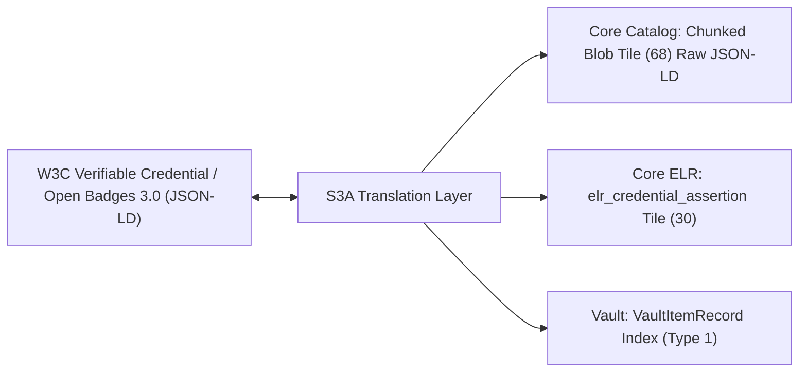
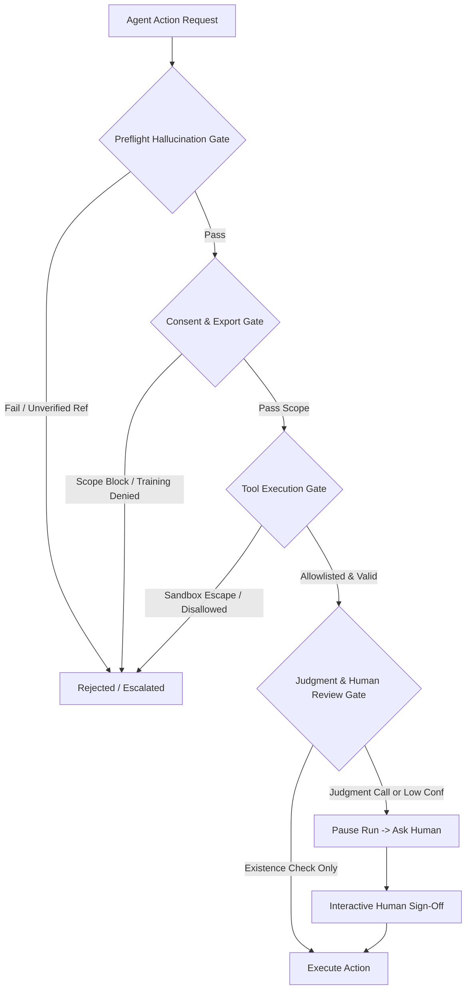

# S3A Digital Vault Specification (S3A-VAULT)

**Document Version:** 1.0-draft  
**Status:** SPECIFIED-ONLY  
**Date:** October 2026  
**License:** [Creative Commons Attribution 4.0 International (CC-BY-4.0)](LICENSE)  
**Patents:** [Royalty-Free Patent Non-Assertion Pledge](PATENTS.md)  
**Parent Specification:** [S3A Hyper-Tile Storage Format Specification](S3A-TILE-SPEC.md)  
**Companion Specification:** [S3A Edge Profile Specification](S3A-EDGE-PROFILE.md)

---

## Specification Audit & Implementation Notice

> [!IMPORTANT]
> **SPECIFICATION AUDIT STATUS: SPECIFIED-ONLY**  
> In accordance with S3A Specification Audit Policy, all constructs, data structures, delegation contracts, physical asset bindings, supervisory gate protocols, transfer chains, and test vectors declared within this document are classified as **SPECIFIED-ONLY**. This specification governs identity custody, verifiable credentials, agent delegations, physical things, supervisory gates, and cryptographic holdings stored natively within standard S3A archives (`.vault.s3a` / `.s3a`).

---

## 1. Conformance, Principles & Explicit Scope

### 1.1 Conformance Terminology

The key words **"MUST"**, **"MUST NOT"**, **"REQUIRED"**, **"SHALL"**, **"SHALL NOT"**, **"SHOULD"**, **"SHOULD NOT"**, **"RECOMMENDED"**, **"NOT RECOMMENDED"**, **"MAY"**, and **"OPTIONAL"** in this document are to be interpreted as described in BCP 14 [RFC 2119] [RFC 8174].

### 1.2 Architectural Foundation: A Vault is an S3A Archive

> **PRIMARY ARCHITECTURAL PRINCIPLE**:  
> An S3A Vault **IS A VALID S3A ARCHIVE FILE** (`.vault.s3a` or `.s3a`).  
> A vault file adheres strictly to the S3A DualFileHeader framing (§2 of `S3A-TILE-SPEC.md`) or the Edge Profile framing (`S3A-EDGE-PROFILE.md`). Any compliant S3A reader, inspector, or compactor can open, inspect, and verify an S3A Vault without specialized proprietary software.

### 1.3 Explicit Non-Financial Scope Boundary

> [!WARNING]
> **STRICT OUT-OF-SCOPE DECLARATION**:  
> The S3A Vault is an architecture for **cryptographic identity, physical asset custody, autonomous agent delegation, educational credentials (W3C VC / Open Badges 3.0), research provenance, supervisory gates, and non-fungible digital holdings**.  
> **Money, fiat currencies, payments, banking transactions, cryptocurrencies, payment tokens, and decentralized finance (DeFi) primitives are STRICTLY OUT OF SCOPE.**

---

## 2. Identities & Key Management

An S3A Vault anchors cryptographically verifiable identities for natural persons, autonomous AI agents, organizations, and physical edge things.

### 2.1 Owner Kinds

An identity in the vault MUST declare one of four canonical owner kinds:

```rust
#[repr(u16)]
pub enum VaultOwnerKind {
    Person = 1,       // Natural human subject / learner / researcher
    Agent = 2,        // Autonomous software / AI agent executing via harness
    Organization = 3, // Academic institution, laboratory, IRB, or enterprise
    Thing = 4,        // Embedded sensors, edge gateways, lab instruments, equipment
}
```

### 2.2 Cryptographic Key Separation & Storage Boundaries

All identity signatures and attestations within the vault use standard **Ed25519** (Edwards-curve Digital Signature Algorithm, RFC 8032):
- **Public Key**: Exactly 32 bytes (`[u8; 32]`).
- **Signature**: Exactly 64 bytes (`[u8; 64]`).

To eliminate key exfiltration vulnerabilities, S3A establishes strict physical and architectural isolation boundaries:

```
+-----------------------------------------------------------------------+
| S3A Cryptographic Key Storage Isolation Boundaries                    |
+-----------------------------------------------------------------------+
| PERSON IDENTITY KEYS:                                                 |
| - Stored exclusively in Hardware Secure Enclaves / Keystores.        |
| - Android: Android Keystore (`MasterKeyProvider`, Hardware StrongBox) |
| - iOS / macOS: Secure Enclave Processor (SEP)                         |
| - Linux / Windows: TPM 2.0 / PKCS#11 Hardware Security Token          |
| - Private key material NEVER touches user-space RAM unencrypted.     |
+-----------------------------------------------------------------------+
| AGENT IDENTITY KEYS:                                                  |
| - Generated and retained exclusively by the runtime harness (e.g.     |
|   `s3a-harness` or sandboxed agent executor).                         |
| - Model Isolation Rule: Private keys are NEVER exposed to the AI      |
|   language model, context window, prompts, or completion buffers.     |
| - Model requests action -> Harness validates grant -> Harness signs.  |
+-----------------------------------------------------------------------+
| ORGANIZATION IDENTITY KEYS:                                           |
| - Multi-signature quorum or FIPS 140-2 Level 3 Hardware Security      |
|   Module (HSM) / Cloud KMS with audit logging.                        |
+-----------------------------------------------------------------------+
| THING IDENTITY KEYS:                                                  |
| - Hardware-anchored crypto elements: Microchip ATECC608A / Optiga    |
|   Trust M, embedded Secure Element (eSE), or firmware TPM / PUF.      |
| - Private key sealed to device firmware integrity; non-extractable.   |
| - Edge runtime signs telemetry & seals micro-tiles on device.         |
+-----------------------------------------------------------------------+
```

### 2.3 VaultIdentityRecord Binary Layout

Identity records are plain-old-data (Pod) structs embedded within an Identity/Record tile:

#### Layout (96 Bytes, 8-Byte Aligned, Little-Endian)
| Offset | Type | Field Name | Description |
|:---:|:---:|:---|:---|
| `0 .. 16` | `[u8; 16]` | `identity_id` | Unique 128-bit UUID identifying this entity. |
| `16 .. 18` | `u16` | `owner_kind` | `1 = Person`, `2 = Agent`, `3 = Organization`, `4 = Thing`. |
| `18 .. 20` | `u16` | `key_algorithm` | MUST be `1` (`ALG_ED25519`). |
| `20 .. 52` | `[u8; 32]` | `public_key` | 32-byte Ed25519 raw public key. |
| `52 .. 84` | `[u8; 32]` | `display_name` | Null-terminated UTF-8 human-readable label. |
| `84 .. 92` | `u64` | `created_at` | Unix epoch timestamp of identity creation. |
| `92 .. 96` | `u32` | `record_crc32` | Castagnoli CRC32C checksum over bytes `0..92`. |

---

## 3. Delegation Grants & Agent Governance

Autonomous AI agents act as representatives of human users, organizations, or supervised physical installations. To prevent unauthorized or rogue operations, all agent capabilities require explicit, cryptographically signed, bounded **Delegation Grants**.

### 3.1 Delegation Grant Structure

A principal issues a grant by signing a `DelegationGrantRecord`:

```
+---------------------------------------------------------------+
| DelegationGrantRecord (192 Bytes, 8-Byte Aligned)             |
|   grant_id: [u8; 16] (128-bit UUID)                           |
|   granter_pubkey: [u8; 32] (Ed25519 Public Key of Principal)  |
|   agent_id: [u8; 16] (UUID of Authorized Agent)               |
|   agent_pubkey: [u8; 32] (Ed25519 Public Key of Agent)        |
|   allowed_actions: u32 (Permitted Capabilities Bitmask)       |
|   allowed_scopes: u32 (Allowed Tile Types / Record Mask)      |
|   max_operations: u32 (Maximum Allowed Action Invocations)    |
|   issued_at: u64 (Unix Epoch Timestamp)                       |
|   expires_at: u64 (Hard Expiration Timestamp)                 |
|   granter_signature: [u8; 64] (Ed25519 Signature by Granter)  |
+---------------------------------------------------------------+
```

#### 3.1.1 Allowed Actions Bitmask (`allowed_actions`)
- `0x0001` — `ACTION_READ`: Query and read holdings and records within allowed scopes.
- `0x0002` — `ACTION_WRITE`: Append new telemetry, notes, or analytical results.
- `0x0004` — `ACTION_SEND_ITEM`: Transfer a holding or credential to an external recipient.
- `0x0008` — `ACTION_ISSUE_CREDENTIAL`: Co-sign or assert an educational/skill competency.
- `0x0010` — `ACTION_ASK_HUMAN`: Route request to human operator for interactive approval.

### 3.2 Anti-Escalation & Governance Rules

The vault engine strictly enforces the following immutable governance invariants:

1. **No Self-Granting**: Agents MUST NOT author, sign, or commit delegation grants to themselves. Grants signed where `granter_pubkey == agent_pubkey` with `owner_kind == Agent` are invalid.
2. **No Widening**: An agent operating under a grant MUST NOT sub-delegate authorities wider than its active grant (`sub_grant.allowed_actions & !active_grant.allowed_actions == 0`).
3. **Mandatory Grant Provenance**: Every write, transfer, or assertion executed by an agent MUST record the `grant_id` relied upon.
4. **Limits & Expiry**: The vault engine tracks operations executed under each grant. Once `invocations >= max_operations` or current time exceeds `expires_at`, further agent requests are rejected (`GrantExpiredOrExhausted`).
5. **Non-Delegable Judgment Actions**:
   > **THE JUDGMENT INVARIANT**:  
   > High-consequence decisions can NEVER be delegated to autonomous models.  
   > Subjective claim assessments (claim support, methodological rigor, overstatement, extrapolation), irreversible record destruction (`erasure`), consent withdrawal (`consent`), physical actuator setpoint overrides, legal waiver signing, and delegation revocation CANNOT be executed autonomously by agents.  
   > When an agent encounters a judgment action, it MUST invoke `ACTION_ASK_HUMAN` to request explicit, interactive human biometric or hardware authorization.

---

## 4. Holdings & Verifiable Credentials

An S3A Vault manages digital holdings, including learning achievements, licenses, intellectual assets, research artifacts, and W3C Verifiable Credentials.

### 4.1 VaultItemRecord Binary Layout

Each holding is registered as an item record:

#### Layout (160 Bytes, 8-Byte Aligned, Little-Endian)
| Offset | Type | Field Name | Description |
|:---:|:---:|:---|:---|
| `0 .. 16` | `[u8; 16]` | `item_id` | Unique 128-bit UUID of the holding. |
| `16 .. 18` | `u16` | `item_type` | Holding category (§4.2). |
| `18 .. 20` | `u16` | `item_flags` | Flags: `0x01 = Unique`, `0x02 = VerifiableCredential`, `0x04 = Encrypted`. |
| `20 .. 52` | `[u8; 32]` | `item_hash` | SHA-256 cryptographic digest of the holding payload. |
| `52 .. 84` | `[u8; 32]` | `issuer_pubkey` | 32-byte Ed25519 public key of the issuing authority. |
| `84 .. 116`| `[u8; 32]` | `current_owner_pubkey`| 32-byte Ed25519 public key of the current owner. |
| `116 .. 124`| `u64` | `acquired_at` | Unix epoch seconds when ownership was registered. |
| `124 .. 128`| `u32` | `consent_scope` | Participant privacy and redistribution mask (§8). |
| `128 .. 144`| `[u8; 16]` | `payload_ref` | Coordinate or Blob UUID referencing raw payload data. |
| `144 .. 156`| `[u8; 12]` | `_reserved` | Explicit zero padding. |
| `156 .. 160`| `u32` | `record_crc32` | Castagnoli CRC32C over bytes `0..156`. |

### 4.2 Canonical Item Categories (`item_type`)
- `0x0001` — `ITEM_VERIFIABLE_CREDENTIAL`: W3C VC or Open Badges 3.0 credential.
- `0x0002` — `ITEM_LEARNER_RECORD`: IEEE P2997 Enterprise Learner Record assertion.
- `0x0003` — `ITEM_RESEARCH_DATASET`: Sealed research dataset artifact or snapshot.
- `0x0004` — `ITEM_ALGORITHMIC_MODEL`: Model weights, fine-tune adapters, or prompt recipes.
- `0x0005` — `ITEM_LICENSE_GRANT`: Digital rights, usage permissions, or data access tokens.
- `0x0006` — `ITEM_BINARY_ATTACHMENT`: Raw PDF, media, or arbitrary scientific asset.

### 4.3 Verifiable Credentials & Open Badges 3.0 Mapping

S3A Vaults provide native, bidirectional mapping for **W3C Verifiable Credentials (VC v2.0)** and **1EdTech Open Badges 3.0**:



1. **Storage Format**:
   - The original JSON-LD credential document is stored verbatim in a Chunked Blob Tile (`blob`, Type ID: `68` / `0x0044`), preserving byte-level integrity for canonical signature verification.
   - Fast query attributes (learner ID, competency URI, achievement title, issuer DID, issue date) are indexed in Core ELR tiles (`elr_credential_assertion`, Type ID: `30` / `0x001E`).
   - A `VaultItemRecord` is committed to represent custody in the vault.
2. **Signature Verification**:
   - The vault engine validates the credential's cryptographic proof suite (`DataIntegrityProof` with `ed25519-2020` cryptosuite or `Ed25519Signature2020`).
   - The issuer DID (e.g. `did:key:z6Mku...`) is resolved to an Ed25519 public key and verified against `issuer_pubkey`.

---

## 5. Transfers & Ownership Chains

Holdings in an S3A Vault can be transferred between vaults or copied with provenance.

### 5.1 ItemTransferRecord Binary Layout

Ownership transitions are recorded as signed transfer links:

#### Layout (176 Bytes + 64 Byte Signature = 240 Bytes, 8-Byte Aligned, Little-Endian)
| Offset | Type | Field Name | Description |
|:---:|:---:|:---|:---|
| `0 .. 16` | `[u8; 16]` | `transfer_id` | Unique 128-bit UUID of the transfer transaction. |
| `16 .. 48` | `[u8; 32]` | `item_hash` | SHA-256 digest of the holding being transferred. |
| `48 .. 80` | `[u8; 32]` | `from_pubkey` | 32-byte Ed25519 public key of the transferring owner. |
| `80 .. 112`| `[u8; 32]` | `to_pubkey` | 32-byte Ed25519 public key of the recipient. |
| `112 .. 120`| `u64` | `timestamp` | Unix epoch timestamp of transfer execution. |
| `120 .. 152`| `[u8; 32]` | `prev_transfer_hash`| SHA-256 digest of prior transfer in the ownership chain. |
| `152 .. 154`| `u16` | `transfer_mode`| `0 = UniqueTransfer`, `1 = CopyWithProvenance` (§5.2). |
| `154 .. 160`| `[u8; 6]` | `_pad` | Alignment padding. |
| `160 .. 172`| `[u8; 12]` | `_reserved` | Reserved zero padding. |
| `172 .. 176`| `u32` | `record_crc32` | Castagnoli CRC32C over bytes `0..172`. |
| `176 .. 240`| `[u8; 64]` | `sender_signature` | Ed25519 signature by `from_pubkey` over bytes `0..176`. |

### 5.2 Transfer Modes

1. **`UniqueTransfer` (`0`)**:
   - Transfers exclusive ownership of a unique holding (e.g., an individual non-fungible certificate or unique license).
   - Once executed, the sender's vault marks the item inactive/tombstoned.
   - The recipient vault appends the transfer link to establish current ownership.
2. **`CopyWithProvenance` (`1`)**:
   - Used for non-exclusive research datasets, educational resources, and badges.
   - Duplicates the holding to the recipient vault while preserving full upstream lineage (`prev_transfer_hash` and `issuer_pubkey`). Both sender and recipient hold valid attested copies.

### 5.3 Ownership Resolution & Double-Send Prevention

$$\text{transfer\_hash}_n = \text{SHA-256}(\text{prev\_transfer\_hash} \parallel \text{item\_hash} \parallel \text{from\_pubkey} \parallel \text{to\_pubkey} \parallel \text{timestamp})$$

1. **Chain Verification**: A verifier traces the transfer chain backward to genesis (`prev_transfer_hash == [0u8; 32]`, signed by `issuer_pubkey`).
2. **Current Owner Rule**: The authoritative current owner of a unique holding is the `to_pubkey` of the highest-sequence validly signed transfer link.
3. **Double-Send Prevention**:
   - **Local Ledger**: The vault engine rejects any transfer where `from_pubkey` has already signed a subsequent transfer for that `item_hash`.
   - **Networked / LRS Registry Check**: For high-assurance institutional transfers, vaults perform an optional consensus lookup against the central S3A LRS server registry (`s3a-lrs-server` state commitment check) to assert no conflicting transfer has been recorded.

---

## 6. Revocation, Key Rotation & Disaster Recovery

### 6.1 Key Rotation (`KeyRotationRecord`)

When an owner upgrades hardware, migrates to a new device, or discovers a compromised key, a `KeyRotationRecord` is committed:

#### Layout (220 Bytes, 8-Byte Aligned, Little-Endian)
| Offset | Type | Field Name | Description |
|:---:|:---:|:---|:---|
| `0 .. 16` | `[u8; 16]` | `rotation_id` | Unique 128-bit UUID. |
| `16 .. 48` | `[u8; 32]` | `old_public_key` | Public key being retired. |
| `48 .. 80` | `[u8; 32]` | `new_public_key` | Newly authorized replacement public key. |
| `80 .. 88` | `u64` | `rotated_at` | Unix epoch timestamp of rotation. |
| `88 .. 152`| `[u8; 64]` | `superseded_sig` | Signature by `old_public_key` authorizing transition. |
| `152 .. 216`| `[u8; 64]`| `confirm_sig` | Signature by `new_public_key` confirming receipt. |
| `216 .. 220`| `u32` | `record_crc32` | Castagnoli CRC32C over bytes `0..216`. |

### 6.2 Revoked-Key Enforcement

The vault maintains an append-only `RevokedKeyRecord` table. Once a key appears in the revocation registry:
1. All future actions, transfers, or grants signed by the revoked key are rejected (`KeyRevokedError`).
2. Prior signatures committed before `rotated_at` remain valid, preserving historical auditability.

### 6.3 Disaster Recovery Mechanisms

1. **Second Device Pairing (Guardian Authorization)**:
   - The user provisionally enrolls a secondary hardware device (e.g. tablet or security key) with an independent keypair.
   - In the event of primary device loss, the secondary device can co-sign a `KeyRotationRecord` alongside an emergency recovery grant.
2. **Deterministic Recovery Phrase**:
   - Standard 12- or 24-word BIP-39 mnemonic seed phrase mapping deterministically via SLIP-0010 to an Ed25519 master identity key (`m/44'/607'/0'/0'/0'`).
3. **Encrypted Vault Backup Container**:
   - Full vault backup exported as an encrypted `.snapshot.s3a` container:
     - Encrypted with **XChaCha20-Poly1305** using a 256-bit symmetric key derived via **Argon2id** (memory: 64 MB, iterations: 3, parallelism: 4) from the user's master passphrase.
     - Protected with Reed-Solomon erasure parity ($K=16, M=2$).
     - Anchored to OpenTimestamps and RFC 3161 calendars.

---

## 7. Append-Only Event History & Cryptographic Sealing

Every action within the vault is permanently recorded in an append-only event log tile.

### 7.1 VaultEventRecord Binary Layout (80 Bytes, 8-Byte Aligned)

| Offset | Type | Field Name | Description |
|:---:|:---:|:---|:---|
| `0 .. 8` | `u64` | `event_sequence`| Monotonically increasing event sequence counter ($1, 2, 3, \dots$). |
| `8 .. 16` | `u64` | `timestamp` | Unix epoch timestamp of event execution. |
| `16 .. 18` | `u16` | `event_type` | Event category (§7.2). |
| `18 .. 20` | `u16` | `actor_kind` | `1 = Person`, `2 = Agent`, `3 = Organization`, `4 = Thing`. |
| `20 .. 36` | `[u8; 16]` | `target_id` | UUID of affected item, grant, key, or gate. |
| `36 .. 68` | `[u8; 32]` | `prev_event_hash`| SHA-256 digest of preceding event record. |
| `68 .. 76` | `u64` | `grant_id_suffix`| Lower 64 bits of `grant_id` relied upon (0 if human/thing). |
| `76 .. 80` | `u32` | `record_crc32` | Castagnoli CRC32C over bytes `0..76`. |

### 7.2 Canonical Vault Event Types (`event_type`)
- `0x0001` — `EVENT_ITEM_RECEIVED`: Inbound transfer or credential import.
- `0x0002` — `EVENT_ITEM_SENT`: Outbound transfer executed.
- `0x0003` — `EVENT_GRANT_ISSUED`: Delegation grant signed for an agent.
- `0x0004` — `EVENT_GRANT_REVOKED`: Delegation grant cancelled early.
- `0x0005` — `EVENT_GRANT_USED`: Agent performed action under active grant.
- `0x0006` — `EVENT_KEY_ROTATED`: Identity keypair rotated.
- `0x0007` — `EVENT_CONSENT_MODIFIED`: Consent scope updated for holding.
- `0x0008` — `EVENT_GATE_EVALUATED`: Supervisory gate evaluated (approved/rejected/escalated).
- `0x0009` — `EVENT_THING_PROVISIONED`: Physical asset enrolled into vault custody.

### 7.3 Container Sealing Integration

Periodically or upon export, the entire vault archive is sealed using S3A Sealed Container v2 framing (§10 of `S3A-TILE-SPEC.md`):
- `SealedIndexHeaderV2` records `seal_generation` and links `prev_seal_hash`.
- `seal_hash` commits to all vault tiles and the complete event history.
- The sealed container endcap (`b"S3AEND\0\x02"`) makes the vault ledger tamper-evident.

---

## 8. Consent Governance & Export Enforcement

Holdings in an S3A Vault carry participant consent metadata honoring GDPR, HIPAA, and IRB research participant rights directly at the storage boundary.

### 8.1 Consent Scope Bitmask (`consent_scope`)

Every `VaultItemRecord` embeds a 32-bit `consent_scope` bitmask:
- `0x0001` — `SCOPE_RESEARCH_ONLY`: Restricted strictly to academic/scientific research; commercial analytics forbidden.
- `0x0002` — `SCOPE_INTERNAL_ENTERPRISE`: Permitted only within the owning organization.
- `0x0004` — `SCOPE_NO_REEXPORT`: Recipient cannot re-transfer or export outside their vault.
- `0x0008` — `SCOPE_HUMAN_APPROVAL_ON_EXPORT`: Autonomous agents CANNOT export this item; requires explicit human biometric consent.
- `0x0010` — `SCOPE_MODEL_TRAINING_FORBIDDEN`: Data cannot be ingested into ML foundation model training pipelines.

### 8.2 Vault Engine Export Gate

When an export or transfer (`send_item`) is requested:
1. The vault engine inspects the item's `consent_scope`.
2. If `SCOPE_HUMAN_APPROVAL_ON_EXPORT` is set and the requester is an AI agent, the engine immediately blocks execution and triggers an interactive `ask_human` prompt.
3. If the destination or intended purpose violates the declared scope, the vault engine refuses transmission (`ConsentViolationError`).

---

## 9. Conformance & Test Vectors

A compliant implementation of the S3A Digital Vault specification MUST pass the four normative test vectors specified below. All vectors are **SPECIFIED-ONLY**.

### 9.1 Normative Test Vector Suite

| Vector ID | Name | Target Mechanism | Description & Validation Criteria |
|:---|:---|:---|:---|
| **`VAULT-VEC-01`** | Signed Transfer Chain | Ownership Lineage | Validates a 3-link ownership chain: Genesis Issue by Issuer $\to$ Transfer to Alice $\to$ Transfer to Bob. Pass if Bob resolves as current owner; fail if intermediate link signature or hash is corrupted. |
| **`VAULT-VEC-02`** | Delegation Grant + Agent Action | Autonomous Governance | Alice signs a delegation grant to Agent Gamma. Agent Gamma executes `ACTION_WRITE` recording `grant_id`. Agent Gamma then attempts a judgment action (`erasure`). Pass if `ACTION_WRITE` succeeds and judgment action is blocked with `RequiresHumanApproval`. |
| **`VAULT-VEC-03`** | Revoked Key Enforcement | Key Management | Key pair $K_1$ signs a rotation record to $K_2$. An action is subsequently attempted using $K_1$. Pass if action is rejected with `KeyRevokedError` while historical actions signed prior to rotation remain valid. |
| **`VAULT-VEC-04`** | W3C VC / Open Badges 3.0 Import | Interoperability | Imports a standard W3C VC v2.0 Open Badges 3.0 JSON-LD document with `Ed25519Signature2020`. Pass if issuer signature verifies, raw JSON-LD is stored in Blob tile (68), and query index is correctly created in `elr_credential_assertion` (30). |

---

## 10. Things (Physical & Edge Assets)

S3A Vaults natively manage physical things: embedded sensors, edge gateways, laboratory instruments, diagnostic hardware, and industrial equipment.

### 10.1 Physical Asset Identity & Hardware Anchoring

Every physical thing represented in an S3A Vault possesses an unforgeable cryptographic identity with `owner_kind == VaultOwnerKind::Thing`:

1. **Hardware Root of Trust**:
   - Device keypairs MUST be generated inside and anchored to tamper-resistant hardware:
     - Dedicated Secure Elements (e.g. Microchip ATECC608A/B, NXP SE050, Infineon Optiga Trust M).
     - Microcontroller/SoC embedded Secure Elements (eSE) or Hardware Security Modules (HSM).
     - Firmware TPM 2.0 or PUF (Physically Unclonable Function) keys.
   - Private keys are non-extractable; signing occurs exclusively within the hardware cryptographic engine.
2. **Thing Identity Record (`ThingIdentityRecord`)**:
   - Plain-old-data record (128 bytes, 8-byte aligned) linking hardware telemetry to the vault:

#### Layout (128 Bytes, 8-Byte Aligned, Little-Endian)
| Offset | Type | Field Name | Description |
|:---:|:---:|:---|:---|
| `0 .. 16` | `[u8; 16]` | `thing_id` | Unique 128-bit UUID assigned to the physical device. |
| `16 .. 32` | `[u8; 16]` | `model_id` | Manufacturer hardware model identifier / UUID. |
| `32 .. 48` | `[u8; 16]` | `serial_number` | Hardware serial number / MAC address (UTF-8 or bytes). |
| `48 .. 56` | `u64` | `firmware_version` | Packed semantic version (`major.minor.patch.build`). |
| `56 .. 88` | `[u8; 32]` | `public_key` | 32-byte Ed25519 raw public key anchored to hardware. |
| `88 .. 96` | `u64` | `provisioned_at` | Unix epoch timestamp of vault provisioning. |
| `96 .. 100` | `u32` | `operational_flags` | Bitmask: `0x01 = Calibrated`, `0x02 = Active`, `0x04 = EdgeProfile`. |
| `100 .. 124`| `[u8; 24]` | `_reserved` | Explicit zero padding. |
| `124 .. 128`| `u32` | `record_crc32` | Castagnoli CRC32C over bytes `0..124`. |

### 10.2 Telemetry Binding & Stream Integrity

Telemetry generated by physical things is cryptographically bound to the device identity:
- **Direct Edge Signing**: Each micro-tile or telemetry block written by the thing carries an on-device Ed25519 signature over its payload hash and `prev_seal_hash` chain (per `S3A-EDGE-PROFILE.md`).
- **Tamper Evidence**: When telemetry is ingested into a parent S3A Vault, the vault retains the device's original seal chain. Modifying or splicing sensor samples breaks the mathematical seal chain.
- **Provenance Attestation**: Scientific analyses run against telemetry records can definitively prove the exact instrument serial number, calibration status, and firmware version that produced each data point.

### 10.3 Equipment Maintenance, Calibration & Operational Logs

Equipment lifecycle events are recorded as immutable, append-only records within the vault:
1. **Operating Events**: Device start/stop timestamps, duty cycles, operating temperature envelopes, and runtime counters.
2. **Calibration Certificates**: Signed calibration records containing calibration standard references, drift measurements, and next-calibration due dates.
3. **Fault Codes & Diagnostic Traces**: Hardware exception events, brownout warnings, communication timeouts, and sensor fault telemetry.
4. **Maintenance Attestations**: Service logs signed by certified service technicians (`VaultOwnerKind::Person`) or automated self-test diagnostics (`VaultOwnerKind::Thing`).

### 10.4 Operational Authority & Control Boundaries

To safeguard physical systems against autonomous misbehavior:
1. **Telemetry vs. Control Separation**: The ability of an agent to read telemetry (`ACTION_READ`) never conveys the authority to actuate machinery or alter configuration.
2. **Actuator Command Gating**: Setpoint changes, calibration adjustments, firmware upgrades, and emergency overrides require an explicit Delegation Grant with `ACTION_WRITE` specifically scoping physical control parameters.
3. **Supervisory Review for Physical Impact**: Parameter changes that could cause physical damage, safety hazards, or process invalidation are classified as non-delegable judgment actions and route unconditionally to the **Human Review Gate** (§11.2).

### 10.5 Mutual Attestation & Provisioning with Edge Profile

Physical things executing the lightweight S3A Edge Profile (`S3A-EDGE-PROFILE.md`) interface seamlessly with S3A Vaults:
1. **Provisioning Handshake**:
   - The device presents its `ThingIdentityRecord` and hardware public key.
   - The vault principal signs a `ProvisioningReceiptRecord` binding the device to the vault namespace.
   - The receipt is written to the device's genesis consent/provisioning tile.
2. **Synchronization Protocol**:
   - Devices sync with parent vaults over BLE, USB, Wi-Fi, serial, or LoRa.
   - Inbound `.edge.s3a` micro-tiles are deduplicated by tile hash; duplicate tiles are ignored without error.
   - The vault merges edge micro-tiles into standard 128 KB hyper-tiles while preserving the device's original `prev_seal_hash` chain and device signature intact.

---

## 11. Gates (Supervisory & Operational Governance)

To enforce verifiable, fail-safe governance over autonomous agents and multi-party workflows, S3A Vaults implement formal **Supervisory Gate Contracts**.

### 11.1 Supervisory Gate Architecture

Gates operate as cryptographic evaluation checkpoints. Every gate invocation, approval, rejection, or escalation is permanently recorded as an immutable Pod struct in the vault event log.

#### SupervisoryGateRecord Layout (128 Bytes + 64 Byte Sig = 192 Bytes, 8-Byte Aligned, Little-Endian)
| Offset | Type | Field Name | Description |
|:---:|:---:|:---|:---|
| `0 .. 16` | `[u8; 16]` | `gate_id` | Unique 128-bit UUID of the gate evaluation. |
| `16 .. 18` | `u16` | `gate_type` | Gate category (§11.2). |
| `18 .. 20` | `u16` | `outcome` | `0 = Pending`, `1 = Approved`, `2 = Rejected`, `3 = Escalated`, `4 = TimedOut`. |
| `20 .. 24` | `u32` | `target_action` | Action code requested (e.g. `ACTION_WRITE`, `ACTION_SEND_ITEM`). |
| `24 .. 40` | `[u8; 16]` | `requested_by` | UUID of the requesting agent or actor. |
| `40 .. 56` | `[u8; 16]` | `target_item_or_task` | UUID of the holding, tool call, or task being evaluated. |
| `56 .. 60` | `u32` | `threshold_confidence`| IEEE 754 32-bit float representing required confidence. |
| `60 .. 64` | `u32` | `observed_confidence` | IEEE 754 32-bit float representing model/evaluator score. |
| `64 .. 72` | `u64` | `evaluated_at` | Unix epoch timestamp of evaluation. |
| `72 .. 80` | `u64` | `expires_at` | Unix epoch timestamp of decision expiration. |
| `80 .. 112`| `[u8; 32]` | `approver_pubkey` | 32-byte Ed25519 public key of human reviewer or authority. |
| `112 .. 124`| `[u8; 12]` | `_reserved` | Explicit zero padding. |
| `124 .. 128`| `u32` | `record_crc32` | Castagnoli CRC32C over bytes `0..124`. |
| `128 .. 192`| `[u8; 64]` | `approver_signature` | Ed25519 signature over bytes `0..128` (zeros if pending/timeout). |

### 11.2 The Four Canonical Gate Types



#### 1. Preflight Hallucination Gate (`GATE_PREFLIGHT_HALLUCINATION = 1`)
- **Purpose**: Verifies all citations, claims, external references, and data assertions before an action is committed.
- **Constraints**: AI models are restricted strictly to verifiable existence checks:
  - Assert DOI exists in canonical registries (OpenAlex, Crossref).
  - Verify document metadata matches cited values.
  - Assert retraction status is clear.
  - Verify exact text passage is present in source archive.
- **Gate Failure**: Any hallucinated, unverified, or retracted reference immediately trips the gate, blocking the action and logging an evaluation event.

#### 2. Human Review Gate (`GATE_HUMAN_REVIEW = 2`)
- **Purpose**: Supervisory intervention for high-consequence judgment calls and sub-threshold confidence decisions.
- **Trigger Conditions**:
  - Any operation classified under the Non-Delegable Judgment Invariant (§3.2, §11.5).
  - Operational routing decisions where observed confidence falls below the agent's configured threshold (`observed_confidence < threshold_confidence`).
- **Behavior**:
  - The agent loop immediately pauses with status `PausedWaitingHuman`.
  - Execution state is frozen into the vault / sandbox run ledger.
  - The human operator reviews the proposed action and submits a signed decision via `s3a-harness resume`.

#### 3. Consent Gate (`GATE_CONSENT = 3`)
- **Purpose**: Enforces subject consent, GDPR, HIPAA, and IRB compliance across transfers, queries, and analytics.
- **Verification Rules**:
  - Inbound and outbound items are checked against their `consent_scope` bitmask.
  - Operations attempting model training without explicit opt-in (`SCOPE_MODEL_TRAINING_FORBIDDEN`) are blocked at the engine layer.
  - If `SCOPE_HUMAN_APPROVAL_ON_EXPORT` is present, export cannot proceed autonomously.

#### 4. Tool Execution Gate (`GATE_TOOL_EXECUTION = 4`)
- **Purpose**: Enforces sandbox isolation, tool parameter schemas, and path boundaries before invoking external or local tools.
- **Isolation Rules**:
  - Enforces strict agent tool allowlists configured in `agents/<id>.toml`.
  - Rejects path traversal escapes (all file writes confined to `<root>/exports`).
  - Records cryptographic hashes of tool inputs (`SHA-256(input)`) and tool outputs (`SHA-256(output)`) into the xAPI provenance ledger.

### 11.3 Multi-Signature Quorums

For institutional or irreversible actions, gates MAY require an $M$-of-$N$ multi-signature quorum:
- **Quorum Scenarios**:
  - Irreversible record erasure (`erasure` tile purge).
  - Identity key revocation or master key rotation.
  - Large-scale credential mass-revocation.
  - Multi-institutional dataset exports.
- **Protocol**: A `QuorumGateRecord` collects $M$ independent Ed25519 signatures from authorized organizational keys before transitioning `outcome` from `Pending` to `Approved`.

### 11.4 Timeout & Escalation Policies

1. **Deterministic Expiration (`expires_at`)**: Every pending gate evaluation defines a maximum lifetime.
2. **Fail-Closed Default**: If `expires_at` is reached without required approvals, the outcome transitions to `TimedOut` and the requested action is rejected without execution.
3. **Single-Escalation Rule**: To prevent runaway escalation loops, an agent run is permitted at most **one** automated model escalation (e.g. switching to a stronger model upon becoming stuck). Subsequent failures route directly to the Human Review Gate.

### 11.5 Non-Delegable Judgment Invariant Integration

The core architectural invariant of the S3A Vault guarantees human primacy over subjective scientific, ethical, and legal decisions:

$$\forall a \in \text{Actions}, \; \text{is\_judgment}(a) \implies \text{delegable}(a) = \text{false}$$

- **Non-Delegable Domain Actions**:
  - Scientific claim support assessments (e.g., whether evidence supports an empirical hypothesis).
  - Methodological rigor evaluations.
  - Scientific overstatement and unwarranted extrapolation assessments.
  - Irreversible data purging and subject consent withdrawal.
  - Legal contract / waiver execution.
- **Enforcement Guarantee**: No prompt, configuration file, model parameter, or delegation grant can override this restriction. A vault engine encountering a judgment action MUST route to `ACTION_ASK_HUMAN`.

---

## 12. Tile ID Registry Harmonization & Conflict Analysis

### 12.1 Allocation Band Review

Per `registry.md` and `S3A-TILE-SPEC.md`, tile type IDs are partitioned into strict bands:
- **0 – 32**: Legacy Frozen Wire Assignments.
- **33 – 63**: Reserved for Standard Domain Packs (allocated via spec amendment).
- **64 – 127**: Core Catalog Primitives.

### 12.2 Conflict-Free Mapping Table

The table below demonstrates how the S3A Vault maps to canonical allocations with **zero collisions**:

| Vault Subsystem / Record | Assigned Wire ID | Hex | Owning Band | Registry Status | Conflict Analysis |
|:---|:---:|:---:|:---|:---|:---|
| **Raw Credential JSON-LD** | `68` | `0x0044` | Core Catalog | Active (`blob`) | **Zero Conflict**. Stores uncompressed or LZ4 VC documents cleanly in standard blob chunks. |
| **Holding Metadata & Items**| `64` | `0x0040` | Core Catalog | Active (`record`) | **Zero Conflict**. Tabular Pod item entries stored in core record tiles. |
| **Container & Ledger Seals** | `70` | `0x0046` | Core Catalog | Active (`seal`) | **Zero Conflict**. Tamper-evident hash chaining and OTS anchoring. |
| **Consent & Governance** | `71` | `0x0047` | Core Catalog | Active (`consent`) | **Zero Conflict**. Uses canonical subject consent primitive. |
| **Agent Action Provenance** | `72` | `0x0048` | Core Catalog | Active (`provenance`) | **Zero Conflict**. Multi-agent lineage tracking linking agent tool steps to grants. |
| **Educational Credentials** | `30` | `0x001E` | Core ELR | Active (`elr_credential_assertion`)| **Zero Conflict**. IEEE P2997 / Open Badges index projection. |
| **Dedicated Vault Pack Range**| `36 – 40`| `0x0024..`| Standard Packs | Reserved (Amendable)| **Zero Conflict**. Standard Domain Pack band (33–63) is completely unallocated; reserved for specialized vault types: `36: vault_identity`, `37: vault_delegation`, `38: vault_holding`, `39: vault_transfer`, `40: vault_event_log`, plus supervisory gate records. |

---

## 13. Summary & Architecture Checklist

1. **Native Format**: An S3A Vault is an ordinary `.s3a` archive (`.vault.s3a`); fully compatible with existing compactors, readers, and verification tools.
2. **Key Custody**: Person keys reside in hardware keystores; agent keys reside in the execution harness and are never exposed to language models; organization keys reside in HSMs; thing keys reside in tamper-resistant secure elements.
3. **Bounded Delegation**: Agents execute under signed, bounded delegation grants; judgment actions can never be delegated and route unconditionally to humans.
4. **Credential Standards**: Direct bidirectional translation between W3C Verifiable Credentials / Open Badges 3.0 and S3A storage primitives.
5. **Ownership Provenance**: Cryptographic transfer hash chains verify current item ownership; optional LRS registry checks prevent double-sends.
6. **Things & Physical Assets**: Hardware-anchored identity binding for physical instruments, on-device telemetry signing, equipment lifecycle logs, and seamless mutual attestation with the Edge Profile (`S3A-EDGE-PROFILE.md`).
7. **Supervisory Gates**: Four canonical gate contracts (Preflight Hallucination, Human Review, Consent, Tool Execution) enforce fail-safe execution, multi-sig quorums, and auditability.
8. **Consent Governance**: Native storage-level consent masks enforce participant privacy, restricting model training and commercial exploitation.
9. **Disaster Recovery**: Guardian device authorization, BIP-39 deterministic recovery phrases, and encrypted snapshot containers with Reed-Solomon parity and OTS anchoring.
10. **Non-Financial Guarantee**: Strictly excludes money, payments, and crypto tokens, focusing exclusively on identity, knowledge, learning credentials, physical assets, supervisory governance, and research data provenance.
